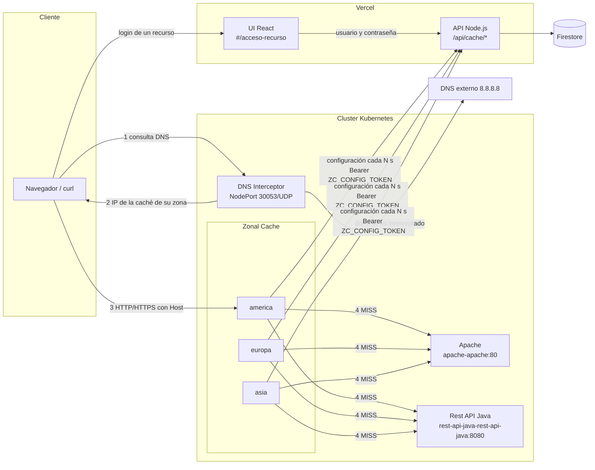
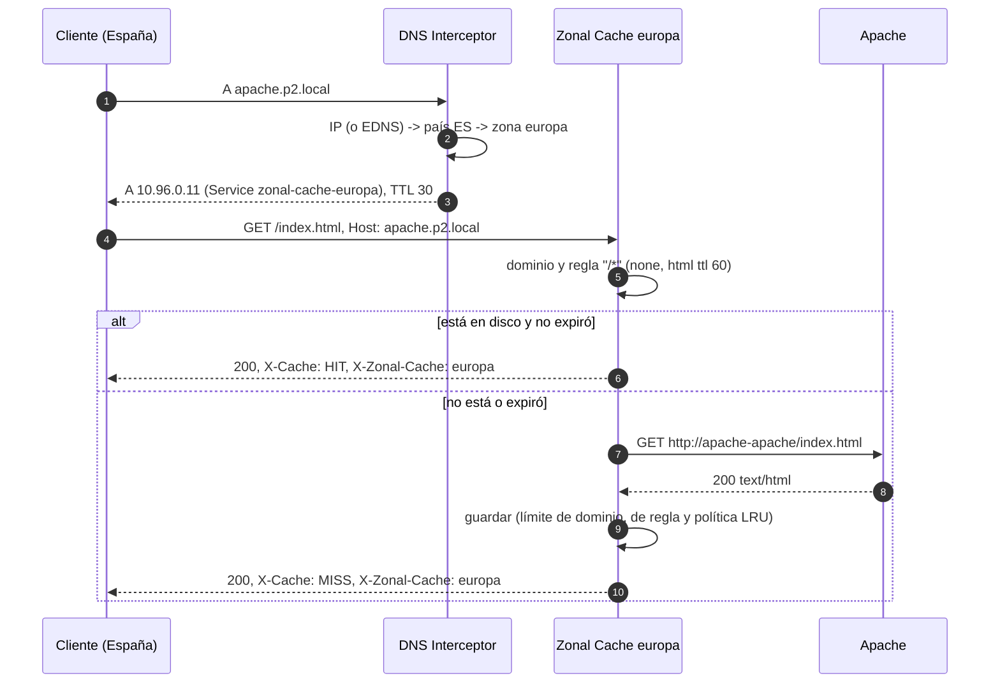
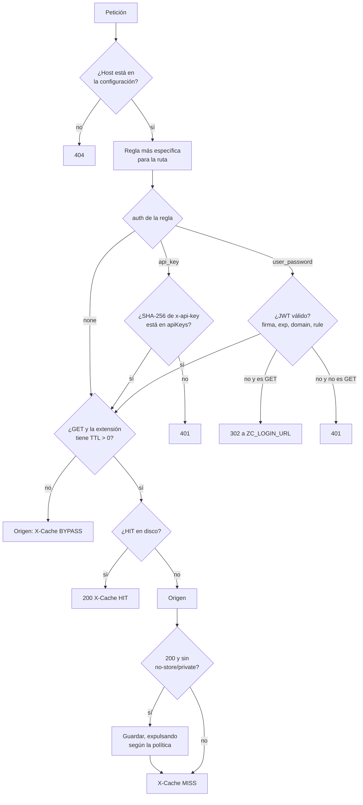
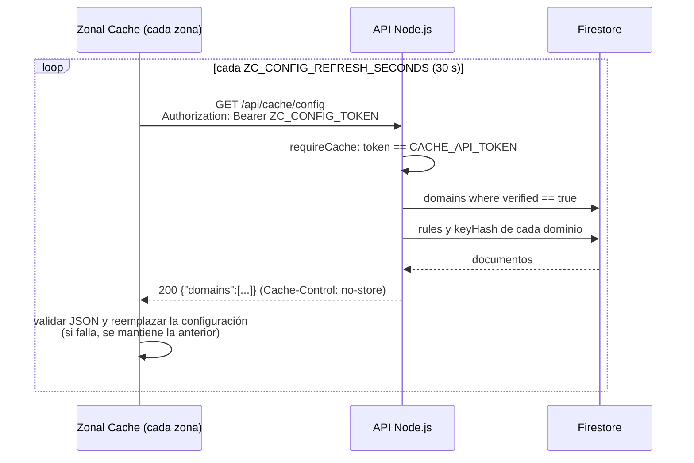
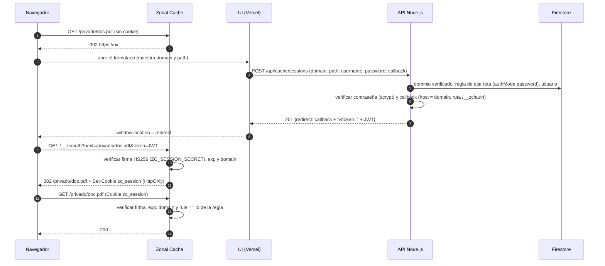
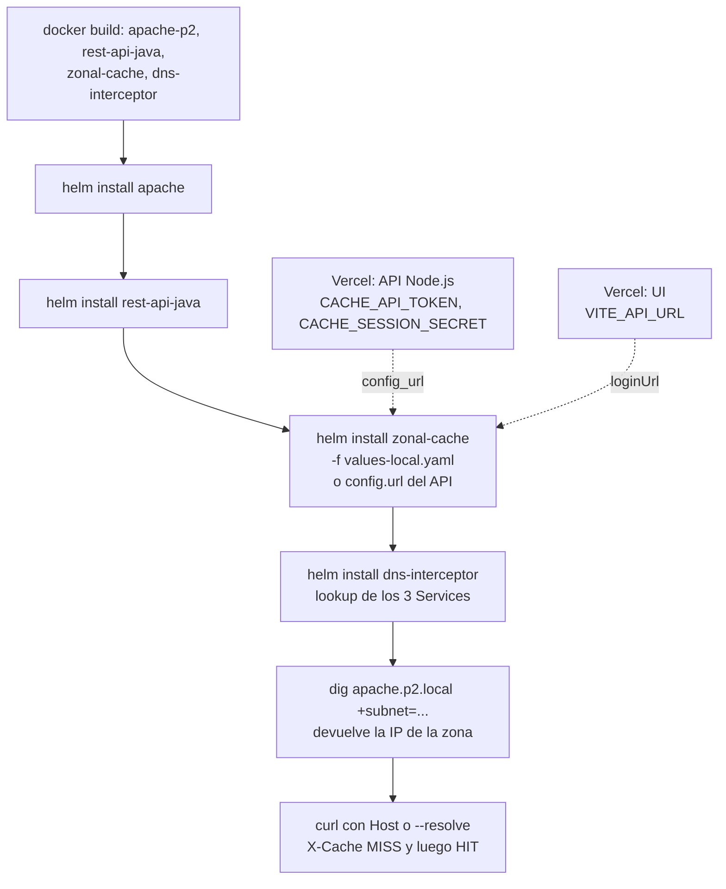

# Integración de los componentes

**Responsable:** Fabricio Herrera (Zonal Cache)

Este documento explica cómo se conecta la Zonal Cache con los componentes de las demás ramas:

- el DNS Interceptor (`feat/dns-interceptor`),
- los charts de Apache y la Rest API Java (`feat/deploy-base`),
- el API Node.js y la UI (`api-ui`).

También indica qué cambios ya se hicieron en la caché y qué falta en cada componente.

Detalle de la caché: [zonal-cache/README.md](../zonal-cache/README.md). Contrato del API: [Contratos/API-Node.md](Contratos/API-Node.md).

## 1. Estructura

```text
2026-02-2023064329-IC7602-P2/
├── dns-interceptor/        GNU C · DNS UDP: dominio interceptado -> IP de la caché de la zona del cliente
├── zonal-cache/            GNU C · proxy HTTP/HTTPS con caché en disco, auth y SSL termination
│   ├── src/                server, proxy, cache, policy, auth, site_config, config_store, origin, ...
│   ├── tests/              pruebas unitarias (make test)
│   └── dev/                configuración y sitio de prueba para docker compose
├── apache/                 servidor de origen (HTML estático)
├── rest-api-java/          servidor de origen (GET/POST/PUT/DELETE sobre /api/items)
├── api-node/               Express + Firebase Admin · panel (UI) y endpoints para las cachés
├── ui/                     React + Vite · panel de dominios y formulario #/acceso-recurso
├── deploy/
│   ├── docker-compose.yml  Apache + Rest API Java sin Kubernetes
│   └── helm/
│       ├── apache/              Service <release>-apache:80
│       ├── rest-api-java/       Service <release>-rest-api-java:8080
│       ├── zonal-cache/         un Deployment + Service por zona: <release>-zonal-cache-<zona>
│       │   └── values-local.yaml  configuración inline para probar todo sin el API
│       └── dns-interceptor/     NodePort 30053/UDP, busca las IPs de las cachés al instalar
└── Docs/
    ├── Contratos/API-Node.md
    └── Integracion.md      (este documento)
```

| Componente | Lenguaje | Dónde corre | Habla con |
| --- | --- | --- | --- |
| DNS Interceptor | C | Kubernetes | Cliente (DNS), DNS externo |
| Zonal Cache (×3 zonas) | C | Kubernetes | Cliente (HTTP/HTTPS), orígenes, API Node.js |
| Apache / Rest API Java | Apache httpd / Java | Kubernetes | Zonal Cache |
| API Node.js | Node.js | Vercel | UI, Zonal Cache, Firestore |
| UI | React | Vercel | API Node.js, Firebase Auth |
| Firestore / Firebase Auth | — | Firebase | API Node.js, UI (solo Auth) |

## 2. Arquitectura



## 3. Comparación: qué espera la caché y qué hay en cada rama

| Punto de integración | La caché espera | Lo que hay en la rama | Estado |
| --- | --- | --- | --- |
| Nombre de las zonas | `america`, `europa`, `asia` (`values.yaml`) | DNS: los mismos nombres en `country_zones.csv` y `values.yaml` | Coincide |
| IP de cada caché | Service `<release>-zonal-cache-<zona>` | DNS: `lookup` del Service `<zonalCache.release>-zonal-cache-<zona>` | Coincide (release `zonal-cache`) |
| Puerto que ve el cliente | Service 80 (HTTP) y 443 (HTTPS) | DNS responde solo con la IP (registro A) | Coincide |
| Dominios atendidos | `domains[].name` de la configuración | DNS: lista fija `apache.p2.local`, `*.cdn.p2.local` | Hay que mantenerlas iguales (sección 7) |
| Servidor de origen | `domains[].origin` o `originUrl` | El formulario pide `originUrl` y la API lo valida y guarda al agregar el dominio | Implementado en API y UI; los dominios anteriores pueden no tenerlo |
| Configuración | `GET ZC_CONFIG_URL` con todos los dominios | API: `GET /api/cache/config` entrega los dominios verificados y sus reglas | Implementado en API; falta conectar el despliegue |
| Autenticar la caché ante el API | `Authorization: Bearer <ZC_CONFIG_TOKEN>` | API: compara el token con `CACHE_API_TOKEN` | Implementado; falta configurar el mismo valor en ambos |
| API keys | SHA-256 en `apiKeys[]` (valida localmente) | API: entrega solo `keyHash` a la caché autenticada | Creación, listado de IDs y eliminación conectados a la UI |
| Formato de reglas | `pattern`, `cacheSize`, `auth`, `fileTypes[].ttl` | API: `pathPattern`, `maxCacheBytes`, `authMode`, `ttlSeconds` | La caché acepta ambos nombres |
| Política de reemplazo | Una por regla | UI: una por tipo de archivo | La caché usa `replacementPolicy` de la regla o la del primer tipo |
| Reglas públicas | `auth: none` | API: `authMode` solo acepta `api-key` o `password` | Falta en API y UI; sin esto no se puede cachear contenido público configurado desde la UI |
| Cualquier tipo de archivo | `fileTypes[].extension: "*"` | API: la validación de extensiones rechaza `*` | Hay que listar cada extensión; las rutas sin extensión cuentan como `html` |
| Dominios verificados | `/api/cache/config` solo entrega `verified: true` | API: `POST /api/domains/:domainId/verify` consulta el TXT | Implementado; falta probar un dominio real con DNS configurable |
| Login de recursos | `ZC_LOGIN_URL?domain&path&callback` → JWT HS256 | UI: `#/acceso-recurso` conectado a `POST /api/cache/sessions` | Implementado; falta probar con la caché desplegada y el secreto compartido |
| Sesión por recurso | Claim `rule` = `id` de la regla | API: firma el dominio, usuario, regla y vencimiento | Implementado en API y caché |
| Cierre de sesión | `/__zc/logout` borra la cookie | UI: enlace al cierre en el dominio del recurso | No requiere otro endpoint en el API; el JWT vence solo |

## 4. Flujos

### 4.1 Petición completa (DNS → caché → origen)



### 4.2 Decisión dentro de la caché



### 4.3 Configuración desde Firestore



Un cambio en la UI (regla nueva, clave revocada, dominio eliminado) llega a las tres cachés en máximo `ZC_CONFIG_REFRESH_SECONDS`.

### 4.4 Login de un recurso con usuario y contraseña



### 4.5 Despliegue



El DNS Interceptor se instala **después** de la caché, porque busca la IP de los Services al instalarse. Si se reinstala la caché y cambian las IPs, hay que ejecutar `helm upgrade dns-interceptor ...` o fijar `zones[].clusterIP`.

## 5. Cambios hechos en la Zonal Cache

| Archivo | Cambio |
| --- | --- |
| [src/site_config.c](../zonal-cache/src/site_config.c), [.h](../zonal-cache/src/site_config.h) | Lee `id` de cada regla, acepta `originUrl` como alias de `origin` y `replacementPolicy` a nivel de regla. |
| [src/auth.c](../zonal-cache/src/auth.c), [.h](../zonal-cache/src/auth.h) | Claim opcional `rule` en el JWT: `auth_token_verify_scope` y `auth_token_create_scoped`, y el estado nuevo `TOKEN_WRONG_RULE`. |
| [src/proxy.c](../zonal-cache/src/proxy.c) | La sesión se valida contra el `id` de la regla. La redirección al login agrega `path` para que la UI y el API conozcan el recurso. |
| [tests/](../zonal-cache/tests) | `token_rule_scope`, `session_is_limited_to_its_rule` y `reads_origin_url_rule_id_and_rule_policy`. También se actualizó la URL esperada del login. |
| [values-local.yaml](../deploy/helm/zonal-cache/values-local.yaml) | Configuración inline con los Services reales de los charts de Apache y la Rest API Java, y los dominios del DNS Interceptor. |
| [values.yaml](../deploy/helm/zonal-cache/values.yaml) | Ejemplos de `origin` y `loginUrl` con los nombres reales. |
| [zonal-cache.yml](../.github/workflows/zonal-cache.yml) | `helm template` con `values-local.yaml`. |
| [zonal-cache/README.md](../zonal-cache/README.md) | Contrato actualizado: `path`, `rule`, `id` y `originUrl`. |
| [src/util.c](../zonal-cache/src/util.c) | Valor inicial correcto de FNV-1a 64 (`14695981039346656037`); antes le faltaba un dígito y fallaba la prueba `fnv_is_deterministic`. |
| [docker-compose.yml](../zonal-cache/docker-compose.yml) | El comando del contenedor `certs` se partía en varias líneas (bloque `>` de YAML con sangría desigual) y `openssl` no recibía `-subj` ni `-keyout`. |
| [deploy/test-k8s.sh](../deploy/test-k8s.sh) | Script nuevo con las pruebas de integración de la sección 8. |

## 6. Cambios necesarios en el API Node.js y la UI

El endpoint `GET /api/cache/config`, el campo `originUrl`, las operaciones de reglas de URL, las API keys y los usuarios de recursos ya están implementados. El login de recursos, la verificación TXT y la eliminación de dominios también están implementados. Falta probar el flujo con un dominio real y la caché desplegada.

### 6.1 Variables de entorno nuevas del API

| Variable del API | Debe ser igual a | Uso |
| --- | --- | --- |
| `CACHE_API_TOKEN` | `ZC_CONFIG_TOKEN` (Secret `config-token` del chart) | Autentica a la caché en `/api/cache/config` |
| `CACHE_SESSION_SECRET` | `ZC_SESSION_SECRET` (Secret `session-secret`) | Firma de los JWT de recursos |
| `CACHE_SESSION_SECONDS` | — (p. ej. `3600`) | Duración de la sesión de un recurso |

Ambos secretos se generan una vez, por ejemplo con `openssl rand -hex 32`. Luego se configuran en Vercel y en el chart con `secrets.existingSecret` o `--set`.

### 6.2 Datos en Firestore

Esta estructura sigue la tabla de la sección 2 de [API-Node.md](Contratos/API-Node.md):

```text
domains/{domainId}              ownerId, name, maxCacheBytes, verified, verificationToken, originUrl
  rules/{ruleId}                pathPattern, maxCacheBytes, authMode, fileTypes[], replacementPolicy (opcional)
    keys/{keyId}                keyHash = sha256(apiKey) en hexadecimal
    users/{userId}              username, passwordHash = "scrypt$<salt>$<hash>"
```

- **`originUrl`** es la dirección base del servidor que la caché consulta en un MISS, por ejemplo `http://apache-apache` dentro del cluster. El formulario la pide al agregar el dominio y `POST /api/domains` valida que use HTTP o HTTPS, sin rutas ni credenciales. Se guarda en Firestore y se entrega en `/api/cache/config`. Los dominios anteriores no se modifican automáticamente.
- **Hashes hacia la caché:** el contrato ya permite entregar los hashes SHA-256 de las API keys para validar `x-api-key` sin llamar al API en cada petición.
  - Se envía solo `keyHash`, por el endpoint autenticado con `CACHE_API_TOKEN`.
  - Los `passwordHash` nunca salen del API.
- **Unicidad:** el id del documento es `<uid>_<dominio>`, así que dos cuentas pueden registrar el mismo dominio. Solo una debería quedar con `verified: true`.

Las reglas ya se pueden listar, crear, editar y eliminar desde la UI. La API comprueba el propietario y guarda solo sus campos de configuración bajo `domains/{domainId}/rules/{ruleId}`. La eliminación borra también sus subcolecciones. Las API keys se crean y eliminan desde la edición de la regla; solo su hash queda guardado y el listado devuelve los IDs. En las reglas con acceso por contraseña se pueden crear, editar y eliminar usuarios. Se guarda `username` y `passwordHash`; el panel recibe solo el ID y el nombre.

### 6.3 Endpoints para las cachés

Implementados en [cache.js](../api-node/cache.js):

- `GET /api/cache/config` exige el token de la caché y entrega los dominios verificados, sus reglas y los hashes de API keys.
- `POST /api/cache/sessions` recibe `{ domain, path, username, password, callback }` desde el formulario público. Busca el dominio verificado y la regla más específica, valida la contraseña con scrypt y responde `201` con `{ redirect, expiresAt }`.

El login elige la regla con más caracteres fijos entre todos los patrones que coinciden, igual que la caché. Esa regla debe usar `password`. No permite usar las credenciales de una regla más general para entrar en otra.

El callback debe usar HTTP o HTTPS, apuntar a `/__zc/auth` del mismo dominio y regresar a la ruta solicitada. El token es un JWT HS256 con `domain`, `sub`, `rule` y `exp`, firmado con `CACHE_SESSION_SECRET`. La duración viene de `CACHE_SESSION_SECONDS`. La caché lo valida con `ZC_SESSION_SECRET` y lo guarda en su cookie. Las respuestas del login usan `Cache-Control: no-store`.

El cierre usa `/__zc/logout`, que borra la cookie. No hay una ruta `DELETE /api/cache/sessions/current` ni documentos de sesiones en Firestore. Un token emitido sigue siendo válido hasta que venza. Eliminar un usuario impide nuevos logins; las eliminaciones de dominios o reglas llegan a la caché cuando actualiza su configuración.

Las rutas para crear y administrar usuarios y claves están en [API-Node.md](Contratos/API-Node.md). Las contraseñas se guardan como `scrypt$<sal hexadecimal>$<hash hexadecimal>` y las API keys como SHA-256 hexadecimal. Ninguna contraseña ni hash de contraseña se entrega a la UI o la caché.

### 6.4 UI

[App.jsx](../ui/src/App.jsx) reconoce `#/acceso-recurso` aunque tenga parámetros después del hash. Esa pantalla no requiere iniciar sesión en el panel.

[ResourceAccess.jsx](../ui/src/pages/ResourceAccess.jsx) muestra el dominio y la ruta recibidos, envía las credenciales al API y abre la dirección de regreso con el token. Si falta un enlace válido, pide abrir el recurso desde su dirección original. El enlace **Cerrar sesión del recurso** usa `/__zc/logout` del mismo dominio.

[VerifyDomain.jsx](../ui/src/pages/VerifyDomain.jsx) consulta el TXT mediante el API y actualiza el dominio en el panel si coincide. La eliminación desde [Domains.jsx](../ui/src/pages/Domains.jsx) pide confirmación y borra el dominio junto con sus subcolecciones.

**[RuleForm.jsx](../ui/src/pages/RuleForm.jsx).** La caché aplica una política por regla, porque `cacheSize` es el límite de toda la regla. Hay dos opciones:

- Mover el selector de política fuera de la tabla de tipos de archivo y guardarlo como `replacementPolicy` de la regla (recomendado).
- Dejarlo por tipo de archivo, sabiendo que la caché usa la del primer tipo.

**[AddDomainDialog.jsx](../ui/src/components/AddDomainDialog.jsx).** El campo "Servidor de origen" (`originUrl`) ya se envía a la API. El detalle del dominio muestra el valor guardado.

## 7. DNS Interceptor

No necesita cambios de código. Ya usa los mismos nombres de zona y de Service.

- **Dominios:**
  - `values.yaml` intercepta `apache.p2.local` y `*.cdn.p2.local`, y [values-local.yaml](../deploy/helm/zonal-cache/values-local.yaml) usa los mismos dominios: `apache.p2.local` y `api.cdn.p2.local`.
  - Al registrar dominios reales en la UI, hay que agregarlos con `--set "domains={a.com,b.com}"`.
  - Pendiente de Nicole y Luis Fernando: que el interceptor lea la lista de dominios verificados del API.
- **IP del Service:**
  - El interceptor responde con la IP `ClusterIP` de la caché. Esa IP solo es alcanzable dentro del cluster.
  - Para probar desde el equipo, se puede usar un pod cliente (sección 8).
  - Otra opción es publicar las cachés con `service.type=LoadBalancer` y fijar `zones.<zona>` en el interceptor con la IP externa.
- **País real:**
  - Con NodePort se pierde la IP del cliente.
  - Para probar las tres zonas se usa `dig +subnet=...` (EDNS Client Subnet), como indica el README del interceptor.

## 8. Prueba de integración local (sin el API)

```bash
# Imágenes (Docker Desktop comparte las imágenes con su Kubernetes)
docker build -t apache-p2 apache
docker build -t rest-api-java rest-api-java
docker build -t zonal-cache zonal-cache
docker build -t dns-interceptor dns-interceptor

# Charts, en este orden
helm install apache deploy/helm/apache
helm install rest-api-java deploy/helm/rest-api-java
helm install zonal-cache deploy/helm/zonal-cache -f deploy/helm/zonal-cache/values-local.yaml
helm install dns-interceptor deploy/helm/dns-interceptor
kubectl get svc                                   # IPs de zonal-cache-zonal-cache-<zona>

# DNS: un cliente de España recibe la IP de la caché de europa
dig +short @127.0.0.1 -p 30053 apache.p2.local +subnet=80.58.61.0/24

# HTTP desde un pod del cluster (la IP es la que devolvió dig)
kubectl run cliente --rm -it --image=curlimages/curl --restart=Never -- sh
curl -si --resolve apache.p2.local:80:<IP> http://apache.p2.local/ | grep -i x-cache     # MISS
curl -si --resolve apache.p2.local:80:<IP> http://apache.p2.local/ | grep -i x-cache     # HIT
curl -sik --resolve apache.p2.local:443:<IP> https://apache.p2.local/                    # SSL termination
curl -si --resolve api.cdn.p2.local:80:<IP> http://api.cdn.p2.local/api/hello            # Rest API Java
curl -si --resolve api.cdn.p2.local:80:<IP> http://api.cdn.p2.local/api/items            # 401 sin x-api-key
curl -si -H 'x-api-key: clave-valida' --resolve api.cdn.p2.local:80:<IP> http://api.cdn.p2.local/api/items
```

Todas estas pruebas, y otras más, están automatizadas en [deploy/test-k8s.sh](../deploy/test-k8s.sh):

```bash
deploy/test-k8s.sh            # integración
deploy/test-k8s.sh --unit     # + pruebas unitarias de la caché y del DNS Interceptor
```

El 03/11/2026, con Kubernetes de Docker Desktop, dio **47 correctas y 0 fallidas**. Cubre:

- el DNS de las tres zonas, el comodín, la zona por defecto, el reenvío y el NodePort desde el equipo;
- health, MISS y luego HIT, y la independencia de cada zona;
- HTTPS;
- `x-api-key` y GET/POST/PUT/DELETE de la Rest API Java;
- los errores `404` y `508`;
- las pruebas unitarias.

Los sitios externos HTTP/HTTPS y la redirección al login no están en `values-local.yaml`; se prueban con `docker compose -f zonal-cache/docker-compose.yml up --build` (ver [zonal-cache/README.md](../zonal-cache/README.md#entorno-local-completo-con-docker-compose)).

Para usar el API en lugar de `values-local.yaml`:

```bash
helm upgrade --install zonal-cache deploy/helm/zonal-cache \
  --set config.url=https://<api>.vercel.app/api/cache/config \
  --set secrets.configToken=$CACHE_API_TOKEN \
  --set secrets.sessionSecret=$CACHE_SESSION_SECRET \
  --set loginUrl='https://<ui>.vercel.app/#/acceso-recurso'
```

## 9. Pendientes

| Pendiente | Responsable |
| --- | --- |
| Probar la verificación TXT con un dominio cuyo DNS se pueda modificar | Nicole |
| Aceptar reglas sin autenticación (`none`) y el tipo de archivo `*` en el API y la UI | Nicole |
| Desplegar el API y la UI en Vercel y conectar la caché con `config.url` | Nicole y Fabricio |
| Probar el login y cierre de sesión con la caché desplegada y el secreto compartido | Nicole y Fabricio |
| Definir si la política de reemplazo es por regla o por tipo de archivo | Nicole y Fabricio |
| Configurar `CACHE_API_TOKEN` y `CACHE_SESSION_SECRET` en Vercel y en el chart; ya están generados localmente | Fabricio y Nicole |
| Sincronizar `DI_DOMAINS` con los dominios verificados | Luis Fernando y Nicole |
| Las respuestas de la Rest API Java guardadas en caché pueden quedar viejas hasta su TTL después de un POST, PUT o DELETE | Documentado; usar TTL bajos en `/api/*` |
