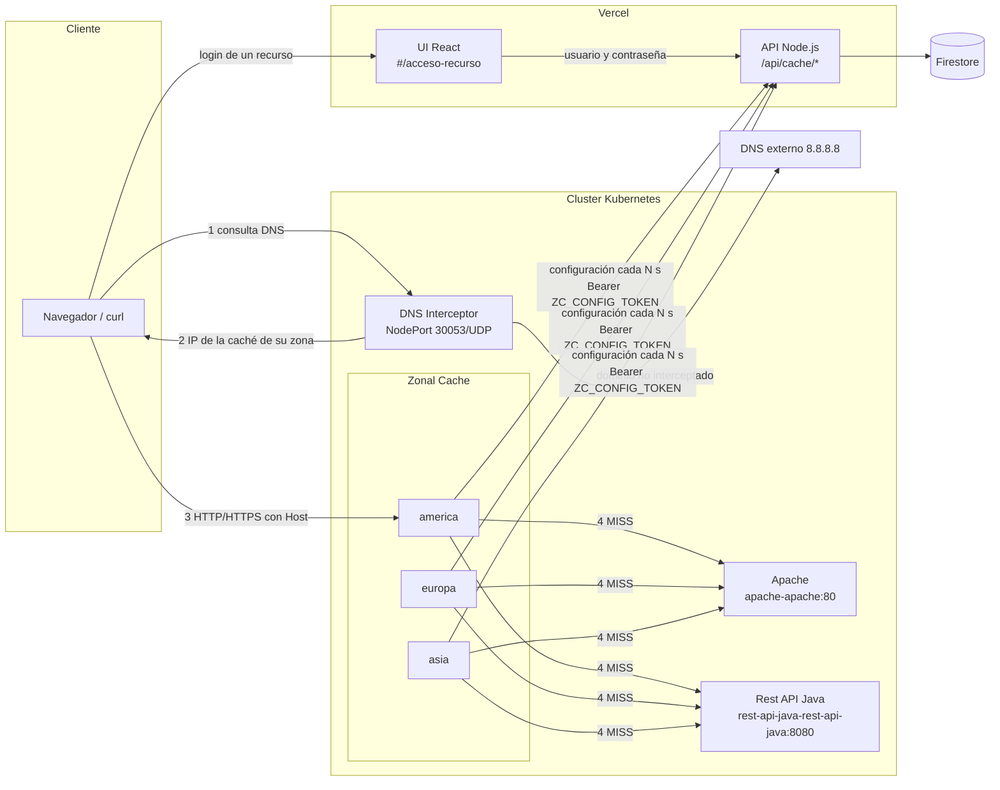
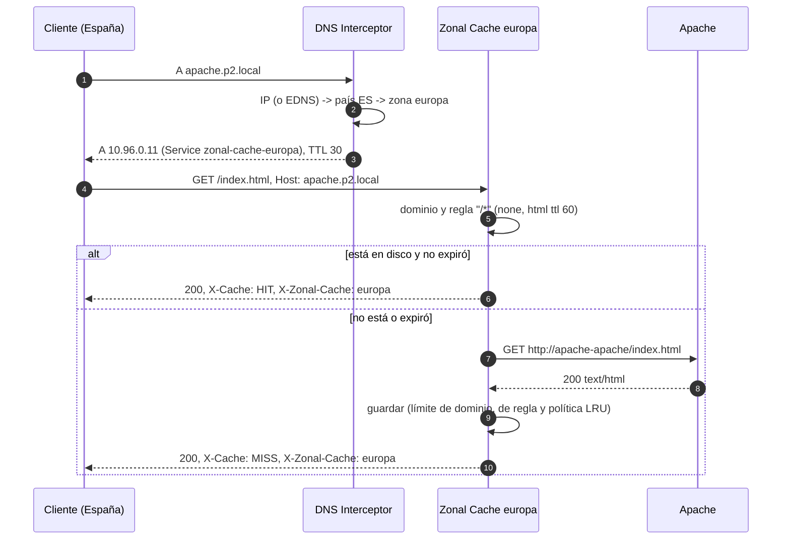
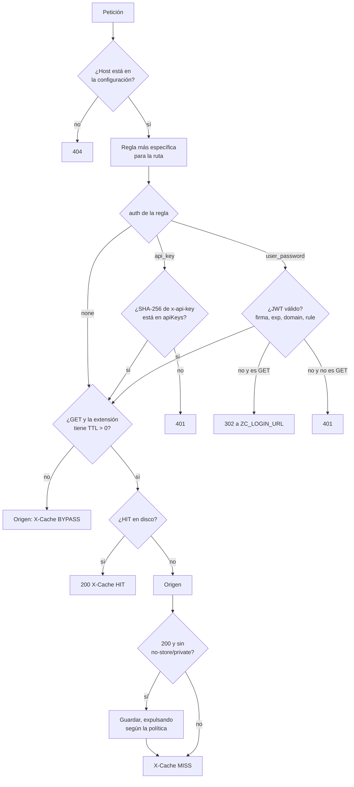
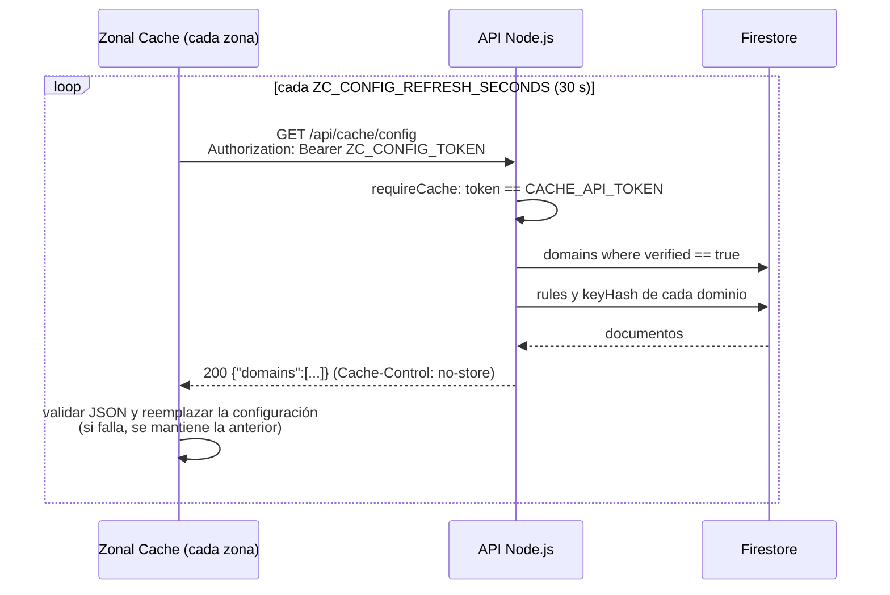
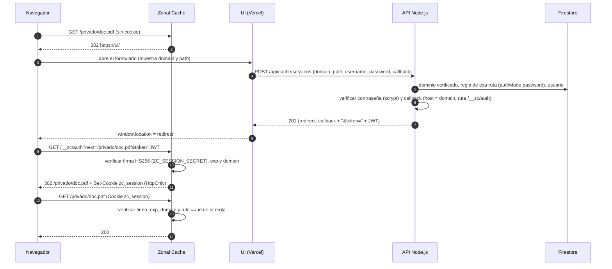
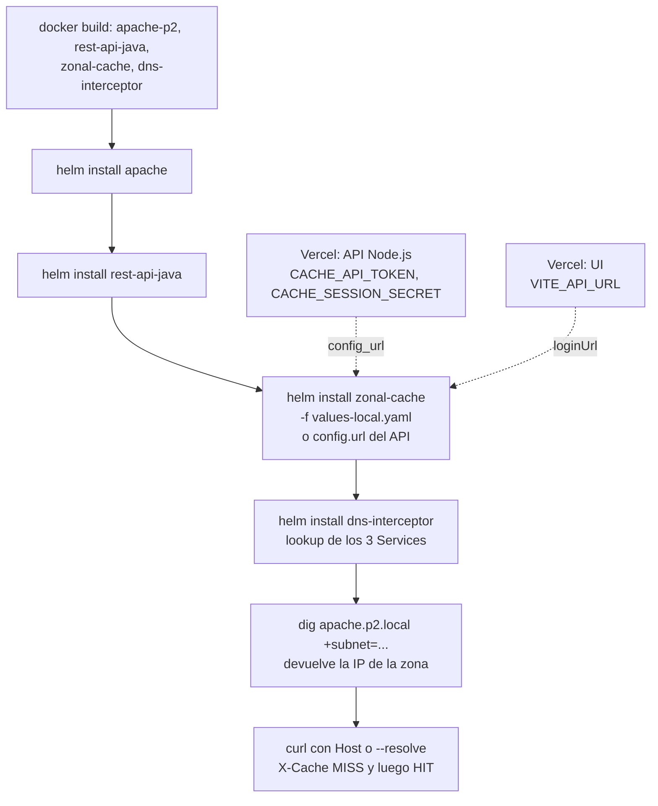

# Integración de los componentes

**Responsable:** Fabricio Herrera (Zonal Cache)

Este documento explica cómo se conecta la Zonal Cache con los componentes de las demás ramas:

- el DNS Interceptor (`feat/dns-interceptor`),
- los charts de Apache y la Rest API Java (`feat/deploy-base`),
- el API Node.js y la UI (`api-ui`).

También indica qué cambios ya se hicieron en la caché y qué falta en cada componente.

Detalle de la caché: [zonal-cache/README.md](../zonal-cache/README.md). Contrato del API: [Contratos/API-Node.md](Contratos/API-Node.md).

## 1. Estructura

```text
2026-02-2023064329-IC7602-P2/
├── dns-interceptor/        GNU C · DNS UDP: dominio interceptado -> IP de la caché de la zona del cliente
├── zonal-cache/            GNU C · proxy HTTP/HTTPS con caché en disco, auth y SSL termination
│   ├── src/                server, proxy, cache, policy, auth, site_config, config_store, origin, ...
│   ├── tests/              pruebas unitarias (make test)
│   └── dev/                configuración y sitio de prueba para docker compose
├── apache/                 servidor de origen (HTML estático)
├── rest-api-java/          servidor de origen (GET/POST/PUT/DELETE sobre /api/items)
├── api-node/               Express + Firebase Admin · panel (UI) y endpoints para las cachés
├── ui/                     React + Vite · panel de dominios y formulario #/acceso-recurso
├── deploy/
│   ├── docker-compose.yml  Apache + Rest API Java sin Kubernetes
│   └── helm/
│       ├── apache/              Service <release>-apache:80
│       ├── rest-api-java/       Service <release>-rest-api-java:8080
│       ├── zonal-cache/         un Deployment + Service por zona: <release>-zonal-cache-<zona>
│       │   └── values-local.yaml  configuración inline para probar todo sin el API
│       └── dns-interceptor/     NodePort 30053/UDP, busca las IPs de las cachés al instalar
└── Docs/
    ├── Contratos/API-Node.md
    └── Integracion.md      (este documento)
```

| Componente | Lenguaje | Dónde corre | Habla con |
| --- | --- | --- | --- |
| DNS Interceptor | C | Kubernetes | Cliente (DNS), DNS externo |
| Zonal Cache (×3 zonas) | C | Kubernetes | Cliente (HTTP/HTTPS), orígenes, API Node.js |
| Apache / Rest API Java | Apache httpd / Java | Kubernetes | Zonal Cache |
| API Node.js | Node.js | Vercel | UI, Zonal Cache, Firestore |
| UI | React | Vercel | API Node.js, Firebase Auth |
| Firestore / Firebase Auth | — | Firebase | API Node.js, UI (solo Auth) |

## 2. Arquitectura



## 3. Comparación: qué espera la caché y qué hay en cada rama

| Punto de integración | La caché espera | Lo que hay en la rama | Estado |
| --- | --- | --- | --- |
| Nombre de las zonas | `america`, `europa`, `asia` (`values.yaml`) | DNS: los mismos nombres en `country_zones.csv` y `values.yaml` | Coincide |
| IP de cada caché | Service `<release>-zonal-cache-<zona>` | DNS: `lookup` del Service `<zonalCache.release>-zonal-cache-<zona>` | Coincide (release `zonal-cache`) |
| Puerto que ve el cliente | Service 80 (HTTP) y 443 (HTTPS) | DNS responde solo con la IP (registro A) | Coincide |
| Dominios atendidos | `domains[].name` de la configuración | DNS: lista fija `apache.p2.local`, `*.cdn.p2.local` | Hay que mantenerlas iguales (sección 7) |
| Servidor de origen | `domains[].origin` | Charts: `apache-apache:80` y `rest-api-java-rest-api-java:8080`. API: el dominio **no tiene campo de origen** | Falta en API y UI |
| Configuración | `GET ZC_CONFIG_URL` con todos los dominios | API: propuesta `GET /api/cache/config?domain=`; no está implementada | Falta en API |
| Autenticar la caché ante el API | `Authorization: Bearer <ZC_CONFIG_TOKEN>` | API: "falta definir" | Se propone en la sección 6.1 |
| API keys | SHA-256 en `apiKeys[]` (valida localmente) | API: guarda `keyHash`, pero dice que los hashes no se envían a las cachés; propone `POST /api/cache/authorize` | Hay que cambiar el contrato (sección 6.2) |
| Formato de reglas | `pattern`, `cacheSize`, `auth`, `fileTypes[].ttl` | API: `pathPattern`, `maxCacheBytes`, `authMode`, `ttlSeconds` | La caché acepta ambos nombres |
| Política de reemplazo | Una por regla | UI: una por tipo de archivo | La caché usa `replacementPolicy` de la regla o la del primer tipo |
| Login de recursos | `ZC_LOGIN_URL?domain&path&callback` → JWT HS256 | UI: `#/acceso-recurso` con datos fijos de ejemplo. API: propone `POST /api/cache/sessions` | Falta en UI y API (secciones 6.3 y 6.4) |
| Sesión por recurso | Claim `rule` = `id` de la regla | API: "la sesión solo sirve para ese recurso" | Agregado en la caché |
| Cierre de sesión | `/__zc/logout` borra la cookie | API: `DELETE /api/cache/sessions/current` | El JWT vence solo; la revocación es opcional |

## 4. Flujos

### 4.1 Petición completa (DNS → caché → origen)



### 4.2 Decisión dentro de la caché



### 4.3 Configuración desde Firestore



Un cambio en la UI (regla nueva, clave revocada, dominio eliminado) llega a las tres cachés en máximo `ZC_CONFIG_REFRESH_SECONDS`.

### 4.4 Login de un recurso con usuario y contraseña



### 4.5 Despliegue



El DNS Interceptor se instala **después** de la caché, porque busca la IP de los Services al instalarse. Si se reinstala la caché y cambian las IPs, hay que ejecutar `helm upgrade dns-interceptor ...` o fijar `zones[].clusterIP`.

## 5. Cambios hechos en la Zonal Cache

| Archivo | Cambio |
| --- | --- |
| [src/site_config.c](../zonal-cache/src/site_config.c), [.h](../zonal-cache/src/site_config.h) | Lee `id` de cada regla, acepta `originUrl` como alias de `origin` y `replacementPolicy` a nivel de regla. |
| [src/auth.c](../zonal-cache/src/auth.c), [.h](../zonal-cache/src/auth.h) | Claim opcional `rule` en el JWT: `auth_token_verify_scope` y `auth_token_create_scoped`, y el estado nuevo `TOKEN_WRONG_RULE`. |
| [src/proxy.c](../zonal-cache/src/proxy.c) | La sesión se valida contra el `id` de la regla. La redirección al login agrega `path` para que la UI y el API conozcan el recurso. |
| [tests/](../zonal-cache/tests) | `token_rule_scope`, `session_is_limited_to_its_rule` y `reads_origin_url_rule_id_and_rule_policy`. También se actualizó la URL esperada del login. |
| [values-local.yaml](../deploy/helm/zonal-cache/values-local.yaml) | Configuración inline con los Services reales de los charts de Apache y la Rest API Java, y los dominios del DNS Interceptor. |
| [values.yaml](../deploy/helm/zonal-cache/values.yaml) | Ejemplos de `origin` y `loginUrl` con los nombres reales. |
| [zonal-cache.yml](../.github/workflows/zonal-cache.yml) | `helm template` con `values-local.yaml`. |
| [zonal-cache/README.md](../zonal-cache/README.md) | Contrato actualizado: `path`, `rule`, `id` y `originUrl`. |

## 6. Cambios necesarios en el API Node.js y la UI

Son propuestas para revisar con Nicole. No se modificaron sus archivos.

### 6.1 Variables de entorno nuevas del API

| Variable del API | Debe ser igual a | Uso |
| --- | --- | --- |
| `CACHE_API_TOKEN` | `ZC_CONFIG_TOKEN` (Secret `config-token` del chart) | Autentica a la caché en `/api/cache/config` |
| `CACHE_SESSION_SECRET` | `ZC_SESSION_SECRET` (Secret `session-secret`) | Firma de los JWT de recursos |
| `CACHE_SESSION_SECONDS` | — (p. ej. `3600`) | Duración de la sesión de un recurso |

Ambos secretos se generan una vez, por ejemplo con `openssl rand -hex 32`. Luego se configuran en Vercel y en el chart con `secrets.existingSecret` o `--set`.

### 6.2 Datos en Firestore

Esta estructura sigue la tabla de la sección 2 de [API-Node.md](Contratos/API-Node.md):

```text
domains/{domainId}              ownerId, name, maxCacheBytes, verified, verificationToken, originUrl (nuevo)
  rules/{ruleId}                pathPattern, maxCacheBytes, authMode, fileTypes[], replacementPolicy (opcional)
    keys/{keyId}                keyHash = sha256(apiKey) en hexadecimal
    users/{userId}              username, passwordHash = "scrypt$<salt>$<hash>"
```

- **`originUrl`** (nuevo) es la URL del servidor de origen que la caché consulta en un MISS, por ejemplo `http://apache-apache` dentro del cluster. Hay que pedirla al agregar el dominio en `AddDomainDialog.jsx` y validarla en `POST /api/domains`. Sin este campo la caché pediría `http://<Host>`, y eso no resuelve dentro del cluster.
- **Hashes hacia la caché:** el contrato dice que los hashes no se envían a las cachés. Sin embargo, la caché necesita el SHA-256 de las API keys para validar `x-api-key` sin llamar al API en cada petición. Llamar al API en cada petición sumaría la latencia de Vercel a cada HIT y la caché dejaría de funcionar si el API cae.
  - Se propone enviar solo `keyHash`, por el endpoint autenticado con `CACHE_API_TOKEN`.
  - Los `passwordHash` nunca salen del API.
- **Unicidad:** el id del documento es `<uid>_<dominio>`, así que dos cuentas pueden registrar el mismo dominio. Solo una debería quedar con `verified: true`.

### 6.3 Endpoints para las cachés (`api-node/cache.js`, propuesta)

```js
import express from 'express';
import { createHmac, scryptSync, timingSafeEqual } from 'node:crypto';
import { getDb } from './firestore.js';

const router = express.Router();

function safeEqual(a, b) {
  const x = Buffer.from(a ?? ''), y = Buffer.from(b ?? '');
  return x.length === y.length && x.length > 0 && timingSafeEqual(x, y);
}

// La caché zonal se autentica con un token propio (distinto de las API keys de los clientes).
function requireCache(req, res, next) {
  const token = req.get('Authorization')?.match(/^Bearer (\S+)$/i)?.[1];
  if (!safeEqual(token, process.env.CACHE_API_TOKEN)) return res.status(401).json({ error: 'Caché no autorizada.' });
  next();
}

// Mismo criterio que zonal-cache/src/wildcard.c: * y ?, gana el patrón con más caracteres fijos.
const toRegExp = (p) => new RegExp('^' + p.replace(/[.+^${}()|[\]\\]/g, '\\$&').replace(/\*/g, '.*').replace(/\?/g, '.') + '$');
const specificity = (p) => p.replace(/[*?]/g, '').length;

function signSession(payload) {
  const enc = (o) => Buffer.from(JSON.stringify(o)).toString('base64url');
  const body = `${enc({ alg: 'HS256', typ: 'JWT' })}.${enc(payload)}`;
  const sig = createHmac('sha256', process.env.CACHE_SESSION_SECRET).update(body).digest('base64url');
  return `${body}.${sig}`;
}

function checkPassword(password, stored) {           // stored = "scrypt$<salt hex>$<hash hex>"
  const [, salt, hash] = String(stored).split('$');
  if (!salt || !hash) return false;
  return safeEqual(scryptSync(password, Buffer.from(salt, 'hex'), 64).toString('hex'), hash);
}

async function verifiedDomain(name) {
  const snap = await getDb().collection('domains').where('name', '==', name).where('verified', '==', true).limit(1).get();
  return snap.docs[0];
}

// GET /api/cache/config: todos los dominios verificados en el formato que lee la caché.
router.get('/config', requireCache, async (req, res) => {
  const domains = await getDb().collection('domains').where('verified', '==', true).get();
  const out = await Promise.all(domains.docs.map(async (d) => {
    const { name, originUrl, maxCacheBytes } = d.data();
    const rules = await d.ref.collection('rules').get();
    return {
      name, originUrl, maxCacheBytes,
      rules: await Promise.all(rules.docs.map(async (r) => {
        const { pathPattern, maxCacheBytes: size, authMode, fileTypes, replacementPolicy } = r.data();
        const keys = authMode === 'api-key' ? (await r.ref.collection('keys').get()).docs.map((k) => k.data().keyHash) : [];
        return { id: r.id, pathPattern, maxCacheBytes: size, authMode, replacementPolicy, fileTypes, apiKeys: keys };
      })),
    };
  }));
  res.set('Cache-Control', 'no-store').json({ domains: out });
});

// POST /api/cache/sessions: login del formulario #/acceso-recurso.
router.post('/sessions', express.json(), async (req, res) => {
  const { domain, path, username, password, callback } = req.body ?? {};
  if (![domain, path, username, password, callback].every((v) => typeof v === 'string' && v)) {
    return res.status(400).json({ error: 'Faltan datos del recurso o las credenciales.' });
  }

  // El token solo se entrega al /__zc/auth del mismo dominio (evita robarlo con un callback ajeno).
  let back;
  try { back = new URL(callback); } catch { return res.status(400).json({ error: 'Callback inválido.' }); }
  if (back.hostname !== domain.toLowerCase() || back.pathname !== '/__zc/auth' || !/^https?:$/.test(back.protocol)) {
    return res.status(400).json({ error: 'Callback inválido.' });
  }

  const denied = () => res.status(401).json({ error: 'Usuario o contraseña incorrectos.' });
  const dom = await verifiedDomain(domain.toLowerCase());
  if (!dom) return denied();
  const rule = (await dom.ref.collection('rules').where('authMode', '==', 'password').get()).docs
    .filter((r) => toRegExp(r.data().pathPattern).test(path))
    .sort((a, b) => specificity(b.data().pathPattern) - specificity(a.data().pathPattern))[0];
  if (!rule) return denied();
  const user = (await rule.ref.collection('users').where('username', '==', username).limit(1).get()).docs[0];
  if (!user || !checkPassword(password, user.data().passwordHash)) return denied();

  const ttl = Number(process.env.CACHE_SESSION_SECONDS) || 3600;
  const exp = Math.floor(Date.now() / 1000) + ttl;
  const token = signSession({ domain: domain.toLowerCase(), sub: username, rule: rule.id, exp });
  back.searchParams.set('token', token);
  res.status(201).json({ redirect: back.toString(), expiresAt: exp });
});

export default router;
```

En [app.js](../api-node/app.js), antes del manejador 404:

```js
import cacheRouter from './cache.js';
app.use('/api/cache', cacheRouter);
```

Al crear un usuario de recurso (`POST /api/rules/:ruleId/users`), la contraseña se guarda así:

```js
const salt = randomBytes(16);
const passwordHash = `scrypt$${salt.toString('hex')}$${scryptSync(password, salt, 64).toString('hex')}`;
```

Las API keys (`POST /api/rules/:ruleId/keys`) se guardan así:

```js
const apiKey = randomBytes(24).toString('base64url');           // se muestra una sola vez
const keyHash = createHash('sha256').update(apiKey).digest('hex');
```

`DELETE /api/cache/sessions/current` no es necesario: la caché borra la cookie en `/__zc/logout` y el JWT vence solo. Si se quiere revocar antes, se puede reducir `CACHE_SESSION_SECONDS`.

### 6.4 UI

**[App.jsx](../ui/src/App.jsx).** La caché agrega parámetros después del hash (`#/acceso-recurso?domain=...`). Por eso hay que comparar la ruta sin la consulta:

```jsx
const [route, setRoute] = useState(window.location.hash);
const routePath = route.split('?')[0];          // nuevo
// ...y usar routePath en lugar de route en las comparaciones con '#/acceso-recurso'
if (routePath === '#/acceso-recurso') return <ResourceAccess />;
```

**[ResourceAccess.jsx](../ui/src/pages/ResourceAccess.jsx).** Hay que reemplazar `exampleResource` y el mensaje fijo por esto:

```jsx
import { apiRequest } from '../api.js';

const params = new URLSearchParams(window.location.hash.split('?')[1] ?? '');
const resource = { domain: params.get('domain') ?? '', path: params.get('path') ?? '/', callback: params.get('callback') ?? '' };

async function handleSubmit(event) {
  event.preventDefault();
  const form = event.currentTarget;
  // ...validación actual del usuario...
  try {
    const { redirect } = await apiRequest('/api/cache/sessions', {
      method: 'POST',
      headers: { 'Content-Type': 'application/json' },
      body: JSON.stringify({
        ...resource,
        username: form.elements.namedItem('resource-username').value.trim(),
        password: form.elements.namedItem('resource-password').value,
      }),
    });
    window.location.assign(redirect);            // vuelve a la caché con el token
  } catch (error) {
    setMessage(error.message);
  }
}
```

Si faltan `domain` o `callback`, la página debe mostrar "Abre el recurso desde su dirección original" en vez del formulario.

**[RuleForm.jsx](../ui/src/pages/RuleForm.jsx).** La caché aplica una política por regla, porque `cacheSize` es el límite de toda la regla. Hay dos opciones:

- Mover el selector de política fuera de la tabla de tipos de archivo y guardarlo como `replacementPolicy` de la regla (recomendado).
- Dejarlo por tipo de archivo, sabiendo que la caché usa la del primer tipo.

**[AddDomainDialog.jsx](../ui/src/components/AddDomainDialog.jsx).** Agregar el campo "Servidor de origen" (`originUrl`).

## 7. DNS Interceptor

No necesita cambios de código. Ya usa los mismos nombres de zona y de Service.

- **Dominios:**
  - `values.yaml` intercepta `apache.p2.local` y `*.cdn.p2.local`, y [values-local.yaml](../deploy/helm/zonal-cache/values-local.yaml) usa los mismos dominios: `apache.p2.local` y `api.cdn.p2.local`.
  - Al registrar dominios reales en la UI, hay que agregarlos con `--set "domains={a.com,b.com}"`.
  - Pendiente de Nicole y Luis Fernando: que el interceptor lea la lista de dominios verificados del API.
- **IP del Service:**
  - El interceptor responde con la IP `ClusterIP` de la caché. Esa IP solo es alcanzable dentro del cluster.
  - Para probar desde el equipo, se puede usar un pod cliente (sección 8).
  - Otra opción es publicar las cachés con `service.type=LoadBalancer` y fijar `zones.<zona>` en el interceptor con la IP externa.
- **País real:**
  - Con NodePort se pierde la IP del cliente.
  - Para probar las tres zonas se usa `dig +subnet=...` (EDNS Client Subnet), como indica el README del interceptor.

## 8. Prueba de integración local (sin el API)

```bash
# Imágenes (Docker Desktop comparte las imágenes con su Kubernetes)
docker build -t apache-p2 apache
docker build -t rest-api-java rest-api-java
docker build -t zonal-cache zonal-cache
docker build -t dns-interceptor dns-interceptor

# Charts, en este orden
helm install apache deploy/helm/apache
helm install rest-api-java deploy/helm/rest-api-java
helm install zonal-cache deploy/helm/zonal-cache -f deploy/helm/zonal-cache/values-local.yaml
helm install dns-interceptor deploy/helm/dns-interceptor
kubectl get svc                                   # IPs de zonal-cache-zonal-cache-<zona>

# DNS: un cliente de España recibe la IP de la caché de europa
dig +short @127.0.0.1 -p 30053 apache.p2.local +subnet=80.58.61.0/24

# HTTP desde un pod del cluster (la IP es la que devolvió dig)
kubectl run cliente --rm -it --image=curlimages/curl --restart=Never -- sh
curl -si --resolve apache.p2.local:80:<IP> http://apache.p2.local/ | grep -i x-cache     # MISS
curl -si --resolve apache.p2.local:80:<IP> http://apache.p2.local/ | grep -i x-cache     # HIT
curl -sik --resolve apache.p2.local:443:<IP> https://apache.p2.local/                    # SSL termination
curl -si --resolve api.cdn.p2.local:80:<IP> http://api.cdn.p2.local/api/hello            # Rest API Java
curl -si --resolve api.cdn.p2.local:80:<IP> http://api.cdn.p2.local/api/items            # 401 sin x-api-key
curl -si -H 'x-api-key: clave-valida' --resolve api.cdn.p2.local:80:<IP> http://api.cdn.p2.local/api/items
```

Para usar el API en lugar de `values-local.yaml`:

```bash
helm upgrade --install zonal-cache deploy/helm/zonal-cache \
  --set config.url=https://<api>.vercel.app/api/cache/config \
  --set secrets.configToken=$CACHE_API_TOKEN \
  --set secrets.sessionSecret=$CACHE_SESSION_SECRET \
  --set loginUrl='https://<ui>.vercel.app/#/acceso-recurso'
```

## 9. Pendientes

| Pendiente | Responsable |
| --- | --- |
| Implementar `GET /api/cache/config` y `POST /api/cache/sessions` (sección 6.3) | Nicole |
| Aceptar en el contrato que `keyHash` se envíe a las cachés por el endpoint autenticado | Nicole y Fabricio |
| Agregar `originUrl` al dominio (API y UI) | Nicole |
| Conectar `#/acceso-recurso` al API y corregir la ruta con parámetros en `App.jsx` | Nicole |
| Definir si la política de reemplazo es por regla o por tipo de archivo | Nicole y Fabricio |
| Generar `CACHE_API_TOKEN` y `CACHE_SESSION_SECRET` y configurarlos en Vercel y en el chart | Fabricio y Nicole |
| Sincronizar `DI_DOMAINS` con los dominios verificados | Luis Fernando y Nicole |
| Las respuestas de la Rest API Java guardadas en caché pueden quedar viejas hasta su TTL después de un POST, PUT o DELETE | Documentado; usar TTL bajos en `/api/*` |
