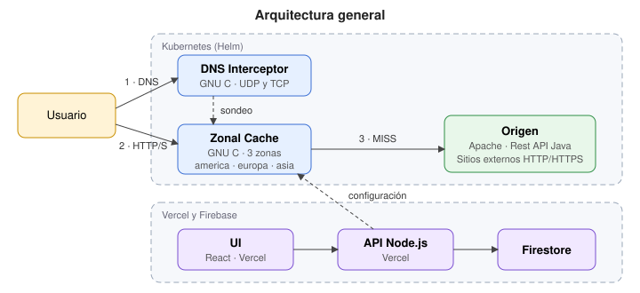
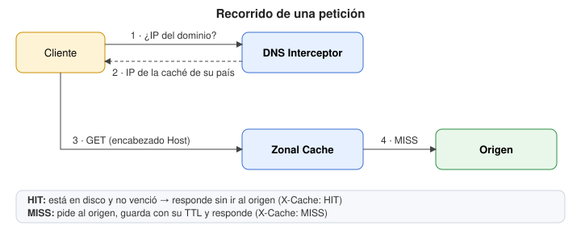
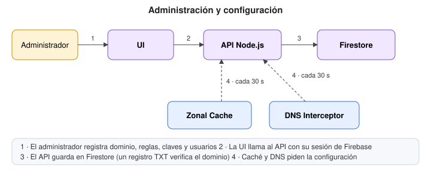
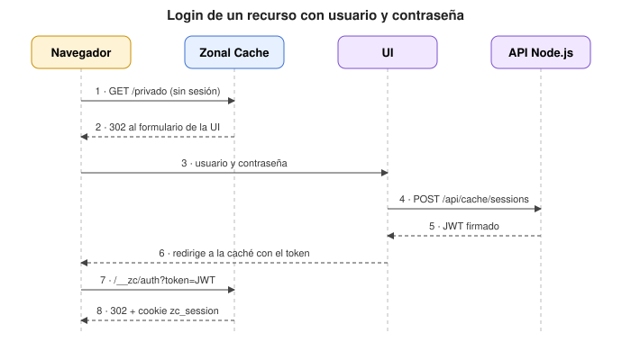
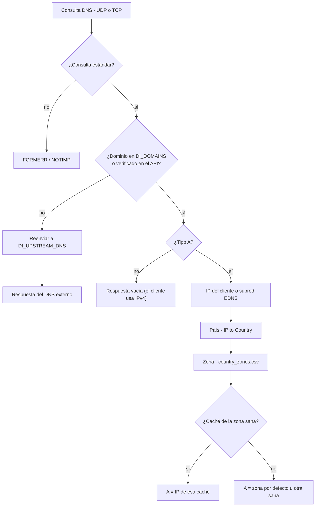

# Proyecto 2: Proxy/Caché de aplicación con geolocalización

**Curso:** Redes (IC 7602) · Escuela de Ingeniería en Computación · Tecnológico de Costa Rica · II Semestre 2026

## Tabla de contenidos

1. [Descripción general](#1-descripción-general)
2. [Integrantes](#2-integrantes)
3. [Arquitectura](#3-arquitectura)
4. [Estructura del repositorio](#4-estructura-del-repositorio)
5. [Requisitos previos](#5-requisitos-previos)
6. [Cómo ejecutar el proyecto](#6-cómo-ejecutar-el-proyecto)
7. [Configuración (variables de entorno)](#7-configuración-variables-de-entorno)
8. [Documentación por componente](#8-documentación-por-componente)
9. [Pruebas realizadas](#9-pruebas-realizadas)
10. [Estado de la implementación](#10-estado-de-la-implementación)
11. [Conclusiones](#11-conclusiones)
12. [Recomendaciones](#12-recomendaciones)
13. [Reportes de avance](#13-reportes-de-avance)
14. [Uso de inteligencia artificial generativa](#14-uso-de-inteligencia-artificial-generativa)
15. [Referencias y créditos](#15-referencias-y-créditos)

---

## 1. Descripción general

**Objetivo general:** implementar un proxy/caché de aplicación con geolocalización.

El sistema intercepta peticiones DNS de dominios específicos, las redirige a una caché HTTP zonal según el país de origen de la persona usuaria, y sirve el contenido desde disco o desde el origen. Cada dominio, URL, política de reemplazo y mecanismo de autenticación se administra desde una interfaz web.

**Objetivos específicos:**

- Desarrollar servidores UDP y TCP en GNU C.
- Procesar peticiones DNS especificadas en el RFC 2929.
- Desarrollar servicios de caché con algoritmos de reemplazo.
- Diseñar servicios de autenticación para APIs y sitios web.
- Diseñar e implementar una aplicación web con inteligencia artificial generativa.
- Implementar una API REST en Java.
- Automatizar la solución con Docker, Helm Charts, Terraform, Docker Compose, Kubernetes o proveedores de nube.

**Lenguajes y tecnologías elegidos** (el enunciado exige documentarlos; **no se permite Python**):

| Componente         | Lenguaje / tecnología                     | Dónde se ejecuta  |
| ------------------ | ----------------------------------------- | ----------------- |
| DNS Interceptor    | GNU C                                     | Kubernetes (Helm) |
| Zonal Cache        | GNU C (OpenSSL, libcurl, cJSON)           | Kubernetes (Helm) |
| Rest API           | Java 21 (servidor HTTP del JDK)           | Kubernetes (Helm) |
| Apache Server      | Apache HTTP Server 2.4                    | Kubernetes (Helm) |
| REST API (Node.js) | Node.js 24 + Express + Firebase/Firestore | Vercel            |
| UI                 | React + Vite + Tailwind CSS               | Vercel            |

## 2. Integrantes

| Carné      | Nombre                       | Componentes a cargo                                                                            |
| ---------- | ---------------------------- | ---------------------------------------------------------------------------------------------- |
| 2023064329 | Luis Fernando Ureña Corrales | DNS Interceptor, Apache, Rest API Java, deploy k8s + Helm, librería de algoritmos de reemplazo |
| 2023097390 | Fabricio Herrera Rodriguez   | Zonal Cache                                                                                    |
| 2023223291 | Nicole Parra Valverde        | REST API Node.js, UI y su deploy en Vercel                                                     |

## 3. Arquitectura

### 3.1 Componentes



| Componente             | Protocolo                                         | Qué hace                                                                                                             |
| ---------------------- | ------------------------------------------------- | -------------------------------------------------------------------------------------------------------------------- |
| DNS Interceptor        | UDP y TCP (puerto 53 del Service, NodePort 30053) | Responde los dominios administrados con la IP de la caché de la zona del cliente; reenvía los demás a 8.8.8.8        |
| Zonal Cache            | TCP: HTTP (80) y HTTPS (443)                      | Autentica, sirve desde disco o pide al origen; una instancia por zona                                                |
| Apache / Rest API Java | HTTP                                              | Servidores de origen dentro del cluster                                                                              |
| REST API Node.js       | HTTPS                                             | Administra dominios, reglas, claves y usuarios en Firestore; entrega la configuración a cachés y DNS; emite sesiones |
| UI                     | HTTPS                                             | Panel de administración y formulario de login de recursos                                                            |

### 3.2 Recorrido de una petición



1. La persona usuaria consulta un dominio administrado. El **DNS Interceptor** determina su país con la base IP to Country y responde con la IP de la **Zonal Cache** de su zona. Si esa caché no responde a su sondeo, usa la zona por defecto u otra sana. Los demás dominios se reenvían a un DNS externo.
2. La Zonal Cache obtiene su configuración desde Firebase a través del API Node.js (o, en pruebas locales, desde un archivo JSON) y la recarga periódicamente.
3. Identifica el dominio por el encabezado `Host` y la regla por la ruta, y valida `x-api-key` o la sesión de usuario/contraseña si la regla lo exige. Las reglas públicas no piden credenciales.
4. Si el recurso está en caché y no expiró, lo sirve (`X-Cache: HIT`). Si no, lo pide al origen, lo guarda aplicando el TTL y la política de su tipo de archivo y los límites de tamaño, y lo sirve (`X-Cache: MISS`). Lo que no se guarda (POST, PUT, DELETE, tipos sin TTL) sale como `X-Cache: BYPASS`.

### 3.3 Administración y configuración



### 3.4 Login de un recurso con usuario y contraseña



Más diagramas: decisión dentro de la caché en [zonal-cache/README.md](zonal-cache/README.md#1-flujo-de-una-petición) e integración entre componentes en [Docs/Integracion.md](Docs/Integracion.md#4-flujos).

## 4. Estructura del repositorio

```text
.
├── Docs/
│   ├── Integracion.md         # Integración entre componentes, flujos y pendientes
│   ├── Contratos/API-Node.md  # Datos y endpoints del API Node.js
│   └── Reportes/              # Reportes semanales de avance
├── dns-interceptor/           # GNU C: servidor DNS UDP/TCP, IP to Country, pruebas, Dockerfile, Compose
├── zonal-cache/               # GNU C: servidor TCP/TLS, caché en disco, pruebas, Dockerfile, Compose
├── rest-api-java/             # Java: API con GET, POST, PUT y DELETE
├── apache/                    # Apache + HTML básico
├── api-node/                  # Node.js + Express (Vercel)
├── ui/                        # React + Vite + Tailwind (Vercel)
├── deploy/
│   ├── helm/                  # Charts: apache, rest-api-java, zonal-cache, dns-interceptor
│   ├── docker-compose.yml     # Apache + Rest API Java sin Kubernetes
│   └── test-k8s.sh            # Pruebas de integración automáticas sobre Kubernetes
├── .github/workflows/         # CI de la Zonal Cache (pruebas unitarias y helm lint)
└── README.md
```

## 5. Requisitos previos

Versiones con las que se probó el proyecto:

| Herramienta               | Versión probada                     | Para qué se usa                                   |
| ------------------------- | ----------------------------------- | ------------------------------------------------- |
| Docker (Docker Desktop)   | 29.2                                | Construir imágenes y ejecutar Docker Compose      |
| Kubernetes                | 1.34 (Kubernetes de Docker Desktop) | Cluster local                                     |
| kubectl                   | 1.35                                | Administrar el cluster                            |
| Helm                      | 4.3                                 | Instalar los charts                               |
| GCC / Make (opcional)     | 13.3 / 4.3                          | Compilar y probar los componentes en C sin Docker |
| JDK                       | 21 (dentro de la imagen, sin Maven) | Compilar la Rest API Java                         |
| Node.js                   | 24.x                                | API Node.js y UI                                  |
| `dig`, `nslookup`, `curl` | —                                   | Probar el sistema                                 |

No hace falta instalar GCC ni el JDK: los Dockerfiles compilan cada componente.

## 6. Cómo ejecutar el proyecto

> **Toda la instalación está automatizada** con Dockerfiles, Docker Compose y Helm Charts.

### 6.1 Clonar el repositorio

```bash
git clone https://github.com/LuisFernandoUC/2026-02-2023064329-IC7602-P2.git
cd 2026-02-2023064329-IC7602-P2
```

### 6.2 Preparar Kubernetes y Helm

1. En Docker Desktop: **Settings → Kubernetes → Enable Kubernetes** (modo _kubeadm_ si se ofrece) → **Apply & Restart**. Con este modo el cluster usa directamente las imágenes construidas con `docker build`.
2. Instalar `kubectl` y `helm`. Por ejemplo, en Ubuntu:

   ```bash
   sudo snap install kubectl --classic
   sudo snap install helm --classic
   kubectl config use-context docker-desktop
   kubectl get nodes          # el nodo docker-desktop debe estar Ready
   ```

No hay valores quemados en el código: toda la configuración se inyecta con variables de entorno ([sección 7](#7-configuración-variables-de-entorno)), que los charts toman de sus `values.yaml`.

### 6.3 Construir las imágenes

```bash
docker build -t apache-p2       apache
docker build -t rest-api-java   rest-api-java
docker build -t zonal-cache     zonal-cache
docker build -t dns-interceptor dns-interceptor
```

### 6.4 Desplegar con Helm

```bash
helm install apache          deploy/helm/apache
helm install rest-api-java   deploy/helm/rest-api-java
helm install zonal-cache     deploy/helm/zonal-cache -f deploy/helm/zonal-cache/values-local.yaml
kubectl wait --for=condition=available deploy --all --timeout=120s
helm install dns-interceptor deploy/helm/dns-interceptor      # siempre de último

kubectl get pods,svc
```

- El **orden importa**: al instalarse, el DNS Interceptor busca la IP de los Services `zonal-cache-zonal-cache-<zona>`. Si se instaló antes que la caché: `helm upgrade dns-interceptor deploy/helm/dns-interceptor`.
- [values-local.yaml](deploy/helm/zonal-cache/values-local.yaml) le da a la caché una configuración fija con Apache (`apache.p2.local`) y la Rest API Java (`api.cdn.p2.local`). Sirve para probar sin depender del API Node.js (ver [sección 10](#10-estado-de-la-implementación)).
- Para usar la configuración de Firebase en su lugar:

  ```bash
  helm upgrade --install zonal-cache deploy/helm/zonal-cache \
    --set config.url=https://zonal-cache-api.vercel.app/api/cache/config \
    --set secrets.configToken=$CACHE_API_TOKEN \
    --set secrets.sessionSecret=$CACHE_SESSION_SECRET \
    --set loginUrl='https://zonal-cache-ui.vercel.app/#/acceso-recurso'
  ```

- Para que el DNS Interceptor también atienda los dominios verificados en la UI (además de `apache.p2.local` y `*.cdn.p2.local`):

  ```bash
  helm upgrade dns-interceptor deploy/helm/dns-interceptor \
    --set domainsSync.url=https://zonal-cache-api.vercel.app/api/cache/config \
    --set domainsSync.token=$CACHE_API_TOKEN
  ```

- Si un pod queda en `ErrImagePull`, agregar `--set image.pullPolicy=Never` al `helm install` de ese chart.

### 6.5 Desplegar el API Node.js y la UI (Vercel)

La API está publicada en [zonal-cache-api.vercel.app](https://zonal-cache-api.vercel.app) y la UI en [zonal-cache-ui.vercel.app](https://zonal-cache-ui.vercel.app). Son dos proyectos de Vercel conectados al mismo repositorio.

1. En Vercel, importar el repositorio de GitHub dos veces: un proyecto con **Root Directory** `api-node` y otro con `ui`. Cada push a la rama configurada despliega automáticamente.
2. Configurar las variables de entorno de cada proyecto ([sección 7](#7-configuración-variables-de-entorno)). En la API, `UI_ORIGIN=https://zonal-cache-ui.vercel.app`; en la UI, `VITE_API_URL=https://zonal-cache-api.vercel.app`. Las claves privadas y los secretos van solo en la API y en la caché, según corresponda.
3. Ejecución local, como alternativa (requiere Node.js 24):

   ```bash
   cd api-node && cp -n .env.example .env # completar FIREBASE_* y CACHE_*
   npm ci && npm run check:firestore && npm run dev

   cd ui && cp -n .env.example .env       # completar VITE_FIREBASE_* y VITE_API_URL
   npm ci && npm run dev                  # http://localhost:5173
   ```

Detalles en [api-node/README.md](api-node/README.md) y [ui/README.md](ui/README.md).

### 6.6 Verificar que todo funciona

El script [deploy/test-k8s.sh](deploy/test-k8s.sh) prueba DNS (UDP y TCP), Apache, Java, las tres cachés, MISS/HIT, SSL termination y `x-api-key` contra el cluster. Crea un pod temporal con `curl`, `dig` y `openssl`, porque las IPs de las cachés son `ClusterIP` y solo se alcanzan desde dentro del cluster.

```bash
deploy/test-k8s.sh                     # pruebas de integración (~30 s)
deploy/test-k8s.sh --unit              # + pruebas unitarias de la caché y del DNS Interceptor
deploy/test-k8s.sh --unit --failover   # + respaldo de zonas: apaga europa y la vuelve a encender
deploy/test-k8s.sh --keep              # conserva el pod de pruebas para seguir probando a mano
```

Termina con código `0` si todas las pruebas pasan. Salida resumida:

```text
== 2. DNS Interceptor (geolocalización por EDNS Client Subnet)
  ✔ apache.p2.local desde 80.58.61.0/24 -> 10.97.215.122 (caché europa)
  ✔ DNS sobre TCP: apache.p2.local desde 1.0.16.0/24 -> 10.102.67.98 (asia)
  ...
== 3. Zonal Cache por zona (health, MISS -> HIT, independencia)
  ✔ [europa] Apache 1.ª petición (200, X-Cache: MISS, zona: europa)
  ✔ [europa] Apache 2.ª petición (200, X-Cache: HIT, zona: europa)
  ...
== 8. Respaldo de zonas (caché europa apagada)
  ✔ Cliente de España con europa apagada -> 10.104.136.190 (otra zona sana)
  ✔ Europa encendida de nuevo: el cliente de España vuelve a 10.97.215.122 (europa)
== Resumen
  50 correctas, 0 fallidas
```

Para comprobar la API y la UI publicadas, ejecutar desde `api-node`:

```bash
API_URL=https://zonal-cache-api.vercel.app UI_URL=https://zonal-cache-ui.vercel.app npm run check:deployment
```

Comprueba disponibilidad, CORS, acceso a Firestore y rechazo de solicitudes sin autorización. Las pruebas con DNS y caché se hacen con el clúster desplegado.

Para probar a mano (`dig`, `curl` desde un pod del cluster, HTTPS y `x-api-key`), ver [Docs/Pruebas-Manuales.md](Docs/Pruebas-Manuales.md). La API key de prueba es `clave-valida`: `values-local.yaml` guarda su SHA-256 (`echo -n clave-valida | sha256sum`).

### 6.7 Entornos con Docker Compose (sin Kubernetes)

| Entorno                          | Comando                                                       | Qué permite probar                                                           |
| -------------------------------- | ------------------------------------------------------------- | ---------------------------------------------------------------------------- |
| Caché + Apache + sitios externos | `docker compose -f zonal-cache/docker-compose.yml up --build` | HIT/MISS, HTTPS, API key, redirección al login, sitios externos HTTP y HTTPS |
| DNS Interceptor                  | `cd dns-interceptor && docker compose up --build`             | Geolocalización con `dig @127.0.0.1 -p 15353 ... +subnet=...`                |
| Apache + Rest API Java           | `docker compose -f deploy/docker-compose.yml up --build`      | Los orígenes directos (puertos 8081 y 8080)                                  |

Los comandos de prueba de cada entorno están en [zonal-cache/README.md](zonal-cache/README.md#entorno-local-completo-con-docker-compose), [dns-interceptor/README.md](dns-interceptor/README.md#con-docker-compose-desarrollo) y [rest-api-java/README.md](rest-api-java/README.md#pruebas).

### 6.8 Desinstalar / limpiar

```bash
helm uninstall dns-interceptor zonal-cache rest-api-java apache
docker compose -f zonal-cache/docker-compose.yml down     # si se usó Docker Compose
```

Para borrar el cluster: Docker Desktop → Settings → Kubernetes → **Reset Kubernetes Cluster**.

## 7. Configuración (variables de entorno)

Toda configuración se inyecta por variables de entorno. En Kubernetes las definen los charts a partir de sus `values.yaml`.

| Componente      | Variable                                                                                                 | Descripción                                                                                          | Ejemplo / valor por defecto                                      |
| --------------- | -------------------------------------------------------------------------------------------------------- | ---------------------------------------------------------------------------------------------------- | ---------------------------------------------------------------- |
| DNS Interceptor | `DI_ZONE_IPS`                                                                                            | IP de cada caché zonal                                                                               | `america=10.0.0.1,europa=...` (obligatoria; el chart la calcula) |
| DNS Interceptor | `DI_DOMAINS`                                                                                             | Dominios interceptados, admite `*.dominio`                                                           | `apache.p2.local,*.cdn.p2.local`                                 |
| DNS Interceptor | `DI_DEFAULT_ZONE`                                                                                        | Zona para países desconocidos o IP privadas                                                          | `america`                                                        |
| DNS Interceptor | `DI_UPSTREAM_DNS`, `DI_UPSTREAM_PORT`                                                                    | DNS externo para los demás dominios                                                                  | `8.8.8.8`, `53`                                                  |
| DNS Interceptor | `DI_TCP`                                                                                                 | `1` atiende también DNS sobre TCP                                                                    | `1`                                                              |
| DNS Interceptor | `DI_DOMAINS_URL`, `DI_DOMAINS_TOKEN`                                                                     | Endpoint y token para leer los dominios verificados del API (opcional)                               | `.../api/cache/config`, igual a `CACHE_API_TOKEN`                |
| DNS Interceptor | `DI_HEALTH_PORT`, `DI_HEALTH_INTERVAL_SECONDS`                                                           | Sondeo TCP de las cachés para el respaldo de zonas; `0` lo desactiva                                 | `80`, `5`                                                        |
| DNS Interceptor | `DI_PORT`, `DI_TTL`, ...                                                                                 | Ver la tabla completa en [dns-interceptor/README.md](dns-interceptor/README.md#variables-de-entorno) | `5353`, `30`                                                     |
| Zonal Cache     | `ZC_*`                                                                                                   | Ver la tabla completa en [zonal-cache/README.md](zonal-cache/README.md#3-variables-de-entorno)       | —                                                                |
| Rest API Java   | `PORT`                                                                                                   | Puerto en el que escucha                                                                             | `8080`                                                           |
| API Node.js     | `HOST`, `PORT`                                                                                           | Dirección y puerto del servidor local                                                                | `127.0.0.1`, `3000`                                              |
| API Node.js     | `UI_ORIGIN`                                                                                              | Origen permitido por CORS                                                                            | `http://127.0.0.1:5173`                                          |
| API Node.js     | `FIREBASE_PROJECT_ID`                                                                                    | ID del proyecto de Firebase                                                                          | `project_id` de la cuenta de servicio                            |
| API Node.js     | `FIREBASE_CLIENT_EMAIL`                                                                                  | Correo de la cuenta de servicio                                                                      | `client_email`                                                   |
| API Node.js     | `FIREBASE_PRIVATE_KEY`                                                                                   | Clave privada de la cuenta de servicio                                                               | `private_key`, entre comillas dobles                             |
| API Node.js     | `CACHE_API_TOKEN`                                                                                        | Token con el que se autentican las cachés; igual a `ZC_CONFIG_TOKEN`                                 | `openssl rand -hex 32`                                           |
| API Node.js     | `CACHE_SESSION_SECRET`                                                                                   | Secreto de al menos 32 bytes para firmar sesiones; igual a `ZC_SESSION_SECRET`                       | `openssl rand -hex 32`                                           |
| API Node.js     | `CACHE_SESSION_SECONDS`                                                                                  | Duración de la sesión del recurso, en segundos                                                       | `3600`                                                           |
| UI              | `VITE_API_URL`                                                                                           | URL del API Node.js                                                                                  | `http://127.0.0.1:3000`                                          |
| UI              | `VITE_FIREBASE_API_KEY`, `VITE_FIREBASE_AUTH_DOMAIN`, `VITE_FIREBASE_PROJECT_ID`, `VITE_FIREBASE_APP_ID` | Configuración web de Firebase Authentication                                                         | Consola de Firebase                                              |

## 8. Documentación por componente

### 8.1 DNS Interceptor

Servidor DNS **UDP y TCP en GNU C**, adaptado del Proyecto 1. Para cada consulta:

1. Si el dominio está en `DI_DOMAINS` (admite `*.dominio`) o entre los dominios verificados que lee del API, obtiene la IP del cliente, o la subred de EDNS Client Subnet si viene, y busca su país en la base _IP to Country_ de db-ip.com (búsqueda binaria sobre ~357 mil rangos en memoria).
2. Convierte el país en zona con [data/country_zones.csv](dns-interceptor/data/country_zones.csv) y responde un registro A con la IP de la caché de esa zona.
3. Si esa caché no responde al sondeo TCP, contesta con la zona por defecto o con otra zona sana (respaldo de zonas).
4. Si el dominio no está interceptado, reenvía la consulta al DNS externo (`DI_UPSTREAM_DNS`) y devuelve su respuesta.



Se despliega con [deploy/helm/dns-interceptor](deploy/helm/dns-interceptor) (Service `NodePort` 30053, UDP y TCP). Documentación completa: [dns-interceptor/README.md](dns-interceptor/README.md).

### 8.2 Zonal Cache

Proxy inverso HTTP/HTTPS en **GNU C**, con un Deployment y un Service por zona. Documentación completa en [zonal-cache/README.md](zonal-cache/README.md):

- flujo de una petición y encabezados que se envían al origen;
- caché en disco con límites por dominio y por URL;
- algoritmos de reemplazo (LRU, LFU, FIFO, MRU, Random);
- autenticación con `x-api-key` y con usuario/contraseña (sesión JWT);
- SSL termination y contrato con el API Node.js;
- pruebas y despliegue con Helm ([deploy/helm/zonal-cache](deploy/helm/zonal-cache)).

### 8.3 Rest API (Java)

API en **Java 21** que usa solo el servidor HTTP del JDK (sin Maven ni frameworks). Implementa GET, POST, PUT y DELETE sobre `/api/items`, más `/health` y `/api/hello`. Los datos viven en memoria. Se compila dentro del Dockerfile y se despliega con [deploy/helm/rest-api-java](deploy/helm/rest-api-java). Endpoints y pruebas: [rest-api-java/README.md](rest-api-java/README.md).

### 8.4 Apache Server

Imagen `httpd:2.4-alpine` que sirve [apache/html/index.html](apache/html/index.html). Es el origen del dominio `apache.p2.local`. Se despliega con [deploy/helm/apache](deploy/helm/apache). Ver [apache/README.md](apache/README.md).

### 8.5 REST API Node.js

Rutas principales: dominios (`/api/domains`, con verificación TXT), reglas de URL, API keys y usuarios por regla, configuración para las cachés (`GET /api/cache/config`) y login de recursos (`POST /api/cache/sessions`). Detalle en [Docs/Contratos/API-Node.md](Docs/Contratos/API-Node.md).

La conexión a Firestore se configura con variables de entorno. El comando `npm run check:firestore`, desde `api-node/`, permite comprobar el acceso.

La API está publicada en Vercel y se comprobó la lectura de Firestore. `proxycache.duckdns.org` ya está verificado por TXT y aparece en `/api/cache/config`. Falta probar el login completo y el acceso a Apache desde la caché del cluster conectada a la API (ver [sección 10](#10-estado-de-la-implementación)). Ver [api-node/README.md](api-node/README.md) y [Docs/Contratos/API-Node.md](Docs/Contratos/API-Node.md).

### 8.6 UI

La UI usa React, Vite y Tailwind CSS. El registro, inicio y cierre de sesión están conectados a Firebase Authentication. Los dominios (con su servidor de origen), las reglas de URL, las API keys y los usuarios de recursos usan la API y Firestore. Una regla puede ser pública, por API key o por usuario y contraseña; desde su edición se administran sus claves o usuarios. La verificación TXT y la eliminación de dominios están conectadas a la API. El formulario de acceso a recursos recibe los datos de la caché y devuelve al usuario con su sesión. Ver [ui/README.md](ui/README.md).

### 8.7 Automatización

| Herramienta       | Archivos                                                                                            | Uso                                                                                           |
| ----------------- | --------------------------------------------------------------------------------------------------- | --------------------------------------------------------------------------------------------- |
| Dockerfile        | `dns-interceptor/`, `zonal-cache/`, `rest-api-java/`, `apache/`                                     | Compilación en varias etapas; imágenes finales sin compiladores y con usuario sin privilegios |
| Docker Compose    | `zonal-cache/docker-compose.yml`, `dns-interceptor/docker-compose.yml`, `deploy/docker-compose.yml` | Entornos de desarrollo sin Kubernetes                                                         |
| Helm Charts       | `deploy/helm/{apache,rest-api-java,zonal-cache,dns-interceptor}`                                    | Despliegue en Kubernetes; la caché crea un Deployment y un Service por zona                   |
| Script de pruebas | `deploy/test-k8s.sh`                                                                                | Pruebas de integración automáticas sobre el cluster                                           |
| GitHub Actions    | `.github/workflows/zonal-cache.yml`                                                                 | Pruebas unitarias, imagen de pruebas, `helm lint` y `helm template`                           |

No se usó Terraform porque todo se ejecuta en Kubernetes local.

## 9. Pruebas realizadas

### 9.1 Pruebas del clúster y Docker Compose

Resultados del 08/11/2026 con Kubernetes de Docker Desktop, después de reinstalar los cuatro charts desde cero como en la [sección 6.4](#64-desplegar-con-helm) e incluir las políticas por tipo de archivo, el DNS sobre TCP y el respaldo de zonas. La caché usa la configuración de prueba `values-local.yaml`; las pruebas 3, 4 y 7 usan Docker Compose (03/11/2026). Estos resultados no prueban el flujo completo con la API de Vercel.

`deploy/test-k8s.sh --unit --failover` → **50 correctas, 0 fallidas**.

| #   | Prueba                                                                               | Pasos para reproducir                                                                                                            | Resultado esperado                                                                                                                             | Resultado obtenido                                                                                                                                                                                                                                                                    |
| --- | ------------------------------------------------------------------------------------ | -------------------------------------------------------------------------------------------------------------------------------- | ---------------------------------------------------------------------------------------------------------------------------------------------- | ------------------------------------------------------------------------------------------------------------------------------------------------------------------------------------------------------------------------------------------------------------------------------------- |
| 1   | Rest API (Java) a través de la caché                                                 | `deploy/test-k8s.sh`, sección 5                                                                                                  | GET `200` (MISS y luego HIT), POST `201`, PUT `200`, DELETE `204`, GET del item borrado `404`. Los métodos que modifican dan `X-Cache: BYPASS` | Correcto                                                                                                                                                                                                                                                                              |
| 2   | Apache con HTML simple                                                               | `deploy/test-k8s.sh`, sección 3                                                                                                  | `200`, `X-Cache: MISS` y luego `HIT` con encabezado `Age`, en cada zona                                                                        | Correcto en las tres zonas                                                                                                                                                                                                                                                            |
| 3   | Sitio externo con **HTTP**                                                           | `docker compose -f zonal-cache/docker-compose.yml up --build`; `curl -i -H "Host: example.com" http://localhost:8080/` dos veces | `200`, MISS y luego HIT                                                                                                                        | Correcto                                                                                                                                                                                                                                                                              |
| 4   | Sitio externo con **HTTPS**                                                          | Mismo entorno; `curl -i -H "Host: www.wikipedia.org" http://localhost:8080/` dos veces                                           | `200`, MISS y luego HIT (la caché habla HTTPS con el origen)                                                                                   | Correcto                                                                                                                                                                                                                                                                              |
| 5   | Resolución DNS con geolocalización                                                   | `deploy/test-k8s.sh`, sección 2, o `dig @127.0.0.1 -p 30053 apache.p2.local +subnet=<subred>`                                    | EE. UU. → america, España → europa, Japón → asia; comodín `*.cdn.p2.local`; `nslookup` sin subred → zona por defecto; google.com se reenvía    | Correcto, también desde el equipo por el NodePort 30053                                                                                                                                                                                                                               |
| 6   | Autenticación con `x-api-key`                                                        | `deploy/test-k8s.sh`, sección 5                                                                                                  | Sin clave `401`, clave incorrecta `401`, `clave-valida` `200`                                                                                  | Correcto                                                                                                                                                                                                                                                                              |
| 7   | Autenticación con usuario y contraseña (sesión)                                      | Entorno Compose de la caché; `curl -i -H "Host: apache.local" http://localhost:8080/privado/secreto.html`                        | `302` al login de la UI con `domain`, `path` y `callback`                                                                                      | Redirección probada. `POST /api/cache/sessions` y el formulario ya están conectados; falta probarlos con la caché desplegada y el secreto compartido. Las pruebas de API comprueban la firma y alcance del JWT; las de caché (`proxy`, `auth`) comprueban su verificación y la cookie |
| 8   | Algoritmos de reemplazo (LRU, LFU, FIFO, MRU, Random) y política por tipo de archivo | `docker build --target test zonal-cache` o `deploy/test-k8s.sh --unit`                                                           | Cada política expulsa la víctima esperada; cada tipo usa su política                                                                           | `102 pruebas, 0 fallidas`                                                                                                                                                                                                                                                             |
| 9   | Límite de tamaño por dominio y por URL                                               | Igual que la #8 (suite `cache`)                                                                                                  | No se superan los límites; los tipos comparten el límite de la regla; un objeto más grande que el límite no se guarda                          | Correcto                                                                                                                                                                                                                                                                              |
| 10  | SSL termination                                                                      | `deploy/test-k8s.sh`, sección 4                                                                                                  | HTTPS `200` con MISS y luego HIT; certificado `CN=zonal-cache`                                                                                 | Correcto                                                                                                                                                                                                                                                                              |
| 11  | Respuestas propias de la caché                                                       | `deploy/test-k8s.sh`, sección 6                                                                                                  | Dominio no administrado `404`; petición repetida entre cachés `508`                                                                            | Correcto                                                                                                                                                                                                                                                                              |
| 12  | Pruebas unitarias del DNS Interceptor                                                | `cd dns-interceptor && make test`                                                                                                | Sin fallas                                                                                                                                     | `185 verificaciones, 0 fallidas`                                                                                                                                                                                                                                                      |
| 13  | DNS sobre TCP                                                                        | `deploy/test-k8s.sh`, sección 2; desde el equipo con `kubectl port-forward` (sección 6.6)                                        | Japón por TCP → IP de la caché asia                                                                                                            | Correcto dentro del cluster. Docker Desktop no reenvía el NodePort TCP al equipo                                                                                                                                                                                                      |
| 14  | Respaldo de zonas                                                                    | `deploy/test-k8s.sh --failover`                                                                                                  | Con europa apagada, un cliente de España recibe otra zona sana; al encenderla vuelve a europa                                                  | Correcto: recibió america (zona por defecto) y luego europa                                                                                                                                                                                                                           |
| 15  | Pruebas unitarias del API Node.js                                                    | `cd api-node && npm test` (Node.js 24)                                                                                           | Sin fallas                                                                                                                                     | `62 pruebas, 0 fallidas` (incluye reglas públicas y tipo `*`)                                                                                                                                                                                                                         |
| 16  | Compilación de la UI                                                                 | `cd ui && npm run build` (Node.js 24)                                                                                            | Compila sin errores                                                                                                                            | Correcto                                                                                                                                                                                                                                                                              |
| 17  | Conexión API Node.js con Firestore                                                   | Desde `api-node/`, configurar `.env` y ejecutar `npm run check:firestore`                                                        | `Conexión con Firestore verificada.`                                                                                                           | Correcto; consulta de lectura realizada                                                                                                                                                                                                                                               |
| 18  | Charts de Helm                                                                       | `helm lint deploy/helm/<chart>`                                                                                                  | Sin errores                                                                                                                                    | Los cuatro charts pasan                                                                                                                                                                                                                                                               |

**Comportamiento esperado, documentado como limitación:** después de un POST a `/api/items`, la lista cacheada sigue sin el item nuevo hasta que vence su TTL (10 s en `values-local.yaml`). El script lo muestra como aviso.

Recomendación del enunciado: usar `nslookup` para el DNS Interceptor y Postman/`curl` para la caché zonal.

### 9.2 Pruebas de API y UI en Vercel

Comprobaciones realizadas el 08/11/2026 con la API y la UI publicadas y Firestore real. Para repetir las operaciones del panel, iniciar sesión y usar un dominio temporal sin verificar, como `pruebas-panel.local`, con origen `http://apache-apache` y límite de 1 MB.

| Prueba                    | Pasos para reproducir                                                                                                                                                                                                  | Resultado obtenido                                                                                                                                                                             |
| ------------------------- | ---------------------------------------------------------------------------------------------------------------------------------------------------------------------------------------------------------------------- | ---------------------------------------------------------------------------------------------------------------------------------------------------------------------------------------------- |
| Disponibilidad y permisos | Desde `api-node/`, ejecutar el comando `check:deployment` de la sección 6.6 con las URLs publicadas y el token local                                                                                                   | API y UI responden `200`; CORS permite la UI; dominios y configuración sin autorización responden `401`; la consulta autenticada lee Firestore con `Cache-Control: no-store`                   |
| Verificación TXT          | En un dominio con DNS editable, publicar el TXT que muestra **Verificar dominio**, verificar y recargar                                                                                                                | `proxycache.duckdns.org` sigue verificado y aparece con su regla en `/api/cache/config`                                                                                                        |
| Reglas de URL             | Crear `/prueba-panel/*` con 0.25 MB, `html`, TTL 60, LRU y acceso por API key. Editar a 0.5 MB, TTL 90 y FIFO; recargar                                                                                                | La creación y la edición conservan los datos. La edición mantiene el ID de la regla                                                                                                            |
| API keys                  | Crear una clave, ocultarla y recargar. Abrir su eliminación y cancelar; luego confirmar la eliminación y recargar                                                                                                      | El valor se muestra solo al crearla. Cancelar conserva la clave; al eliminarla desaparece también después de recargar                                                                          |
| Usuarios de recursos      | Cambiar y guardar el acceso de la regla a **Usuario y contraseña**. Crear un usuario temporal, editar su nombre con contraseña vacía y después guardar una nueva contraseña desde el formulario. Eliminarlo y recargar | El nombre se guarda y se puede editar. El formulario confirma el guardado de la nueva contraseña. El usuario eliminado no reaparece. El login con esa contraseña no se comprobó en esta prueba |
| Eliminación y limpieza    | Eliminar la regla temporal y después el dominio; recargar ambas listas                                                                                                                                                 | La regla y el dominio desaparecen. Se conservaron el dominio verificado, su regla `/*` y el usuario `prueba3`                                                                                  |
| Dominios pendientes       | Consultar `/api/cache/config` con el token de la caché mientras existe el dominio temporal sin verificar                                                                                                               | El dominio temporal queda fuera de la configuración                                                                                                                                            |

También se ejecutó la caché local con la API real de Vercel: cargó la configuración, respondió a su comprobación de salud y redirigió al login público. Un token inválido en el callback respondió `401` y `/__zc/logout` respondió `200` borrando la cookie. No se sirvieron archivos de Apache en esa ejecución.

Las pruebas actuales de la caché dieron **102 correctas y 0 fallidas**, incluidas las políticas distintas por tipo de archivo y los límites compartidos, y ese cambio ya está desplegado y probado en el clúster (sección 9.1). Falta probar el login válido, Apache con MISS/HIT y el acceso después de cerrar sesión con la caché del clúster conectada a la API real y el secreto compartido. Los pasos son los de la [sección 6.4](#64-desplegar-con-helm) con la configuración de Firebase; después, abrir el `Location` del `302` en el navegador, iniciar sesión con `prueba3` y repetir la petición con la cookie `zc_session`.

## 10. Estado de la implementación

| Aspecto                  | Funciona                                                                                                                                                                                                                                                                                             | No funciona / limitaciones                                                                                                                                                                                                                                 | Notas                                                                                                                                                                 |
| ------------------------ | ---------------------------------------------------------------------------------------------------------------------------------------------------------------------------------------------------------------------------------------------------------------------------------------------------- | ---------------------------------------------------------------------------------------------------------------------------------------------------------------------------------------------------------------------------------------------------------- | --------------------------------------------------------------------------------------------------------------------------------------------------------------------- |
| DNS Interceptor          | Respuestas A según el país (IP to Country y EDNS Client Subnet), UDP y TCP, comodines, zona por defecto, respaldo de zonas por sondeo TCP, dominios verificados leídos del API (opcional), reenvío al DNS externo, despliegue con Helm que obtiene solo las IPs de las cachés, 185 pruebas unitarias | Solo IPv4. Con Docker Desktop el cliente llega con la IP del gateway (se prueba con EDNS Client Subnet) y el NodePort TCP no llega al equipo (se usa `port-forward`). La sincronización con el API no se probó en el cluster porque requiere el token real | Ver [dns-interceptor/README.md](dns-interceptor/README.md#qué-funciona-y-qué-no)                                                                                      |
| Zonal Cache              | Servidor TCP con SSL termination, caché en disco con límites por dominio y por URL, LRU/LFU/FIFO/MRU/Random, TTL y política por tipo de archivo, autenticación pública, `x-api-key` y sesiones JWT, redirección al login, orígenes HTTP y HTTPS, recarga de configuración, un despliegue por zona    | La lectura de la API real se probó solo desde una caché local; en el clúster las pruebas usan `values-local.yaml`. Sin keep-alive; no respeta `Vary`                                                                                                       | Ver [zonal-cache/README.md](zonal-cache/README.md#9-estado)                                                                                                           |
| RestAPI Node.js / UI     | API y UI publicadas en Vercel; cuentas con Firebase Authentication; administración de dominios, reglas (públicas, API key o usuario y contraseña; tipo `*`), API keys y usuarios; TXT real verificado; configuración de cachés con Firestore; endpoint de login con JWT                              | Falta comprobar el login válido, MISS/HIT de Apache y cierre de sesión con la caché del clúster y el secreto compartido. Las reglas públicas y el tipo `*` están en el código pero aún no publicados en Vercel                                             | Las pruebas unitarias simulan Firebase y DNS; las del panel usan Vercel y Firestore reales. Ver sección 9.2 y [Docs/Integracion.md](Docs/Integracion.md#9-pendientes) |
| Rest API / Apache Server | GET, POST, PUT y DELETE en Java; HTML en Apache; ambos con Dockerfile, Helm y Docker Compose, probados a través de la caché                                                                                                                                                                          | Los datos de la Rest API Java viven en memoria y se pierden al reiniciar el pod                                                                                                                                                                            | —                                                                                                                                                                     |

## 11. Conclusiones

1. Separar la lógica del proxy de los sockets (`proxy_handle` recibe una función de origen) permitió probar el flujo completo de la caché sin red, con un origen falso.
2. EDNS Client Subnet hace posible probar la geolocalización desde una sola máquina: sin esa extensión, todas las consultas llegarían con la IP privada del cluster y caerían en la zona por defecto.
3. La caché solo ofrece garantías reales si TTL y política de reemplazo trabajan juntos: el TTL decide cuándo un objeto deja de ser válido y la política decide quién sale cuando falta espacio.
4. Cada regla de URL tiene un límite compartido por sus tipos de archivo. Cada tipo usa su política de reemplazo, sin multiplicar el espacio permitido para la regla.
5. Guardar solo el SHA-256 de las API keys y compararlo en tiempo constante protege las claves aunque se filtre la configuración.
6. Validar las sesiones con un JWT firmado permite autenticar cada petición sin consultar al API, a cambio de no poder revocar una sesión antes de que venza.
7. La SSL termination simplifica los orígenes, que no necesitan certificados, y concentra el manejo de TLS en un solo componente.
8. Kubernetes y Helm permiten desplegar varias zonas a partir de un solo chart. Generar un Deployment y un Service por zona fue clave para que el DNS Interceptor encontrara las IPs automáticamente.
9. Inyectar toda la configuración por variables de entorno permitió usar la misma imagen en Docker Compose, en Kubernetes y en el CI.
10. Acordar un contrato de datos temprano y aceptar en la caché los dos formatos de nombres de campos redujo el costo de integrar componentes desarrollados en paralelo.
11. Las pruebas de integración automáticas (`deploy/test-k8s.sh`) detectan en segundos problemas que a mano tomarían varios minutos de comandos repetidos.
12. Sondear las cachés desde el DNS Interceptor y desviar a una zona sana mantiene el servicio cuando falla una zona completa, a cambio de mayor latencia para esos clientes.

## 12. Recomendaciones

1. Completar las pruebas de la caché desplegada con el dominio ya verificado y la API de Vercel; dejar `values-local.yaml` para desarrollo.
2. Al probar la administración de dominios, reglas, claves y usuarios, comprobar con dos cuentas que cada una solo pueda acceder a sus propios datos.
3. Activar `domainsSync` en el DNS Interceptor con el token real, para que atienda los dominios verificados en la UI sin editar `values.yaml`.
4. Agregar keep-alive y un pool de hilos con `epoll` a la caché si se espera mucha concurrencia, para no crear un hilo y un handshake TLS por petición.
5. Invalidar en la caché las entradas de una ruta cuando pasa por ella un POST, PUT o DELETE, para no servir datos viejos hasta que venza el TTL.
6. Persistir el índice de la caché en disco, para no perder el contenido al reiniciar un pod.
7. Publicar las cachés con `LoadBalancer` o `externalTrafficPolicy: Local` en un cluster real, para que los clientes externos lleguen a ellas y se conserve su IP real.
8. Usar certificados de una autoridad reconocida (por ejemplo, cert-manager con Let's Encrypt) en lugar del certificado autofirmado del chart.
9. Agregar a GitHub Actions el DNS Interceptor, el API Node.js y el script de integración sobre un cluster efímero (kind), no solo la caché.
10. Respetar el encabezado `Vary` del origen, o incluirlo en la clave de caché, antes de cachear respuestas que cambian por idioma o por usuario.
11. Integrar los componentes cada semana: los ajustes del origen, el formato de reglas y las políticas por tipo de archivo se detectaron al conectar el API con la caché.

## 13. Reportes de avance

Los reportes semanales se encuentran en [`Docs/Reportes/`](Docs/Reportes/).

| Reporte | Fecha      | Archivo                      |
| ------- | ---------- | ---------------------------- |
| P2R1    | 15/10/2026 | [R1.md](Docs/Reportes/R1.md) |
| P2R2    | 22/10/2026 | [R2.md](Docs/Reportes/R2.md) |
| P2R3    | 29/10/2026 | [R3.md](Docs/Reportes/R3.md) |

## 14. Uso de inteligencia artificial generativa

El uso de IA está regulado por el documento _Política para el Uso de Inteligencia Artificial Generativa_.

| Herramienta             | Para qué se usó                                                                                                                                                                                                                                                                                                                                                                                                                           | Cómo se verificó                                                                                                                                                                                                      |
| ----------------------- | ----------------------------------------------------------------------------------------------------------------------------------------------------------------------------------------------------------------------------------------------------------------------------------------------------------------------------------------------------------------------------------------------------------------------------------------- | --------------------------------------------------------------------------------------------------------------------------------------------------------------------------------------------------------------------- |
| Claude Code (Anthropic) | Análisis del avance contra el enunciado; corrección del comando del contenedor `certs` en `zonal-cache/docker-compose.yml` y del valor inicial del hash FNV-1a 64 en `zonal-cache/src/util.c`; script `deploy/test-k8s.sh` (incluidas las pruebas de DNS sobre TCP y respaldo de zonas); fusión de `feat/dns-interceptor`; reglas públicas y tipo `*` en `api-node/rules.js` y la UI; actualización de esta documentación y sus diagramas | Pruebas unitarias (102 de 102 en la caché, 185 de 185 en el DNS, 62 de 62 en el API), compilación de la UI, ejecución del script contra el cluster (50 de 50), `helm lint` de los cuatro charts y revisión del equipo |

## 15. Referencias y créditos

El enunciado exige reconocer al autor de cualquier código o configuración tomado de Internet; usar código sin reconocimiento se considera copia.

| Recurso                                                                                     | Autor / fuente                                                                                  | Dónde se usa                                                       |
| ------------------------------------------------------------------------------------------- | ----------------------------------------------------------------------------------------------- | ------------------------------------------------------------------ |
| IP to Country Lite (CC BY 4.0)                                                              | [db-ip.com](https://db-ip.com)                                                                  | `dns-interceptor/data/dbip-country-lite.csv.gz`                    |
| cJSON (MIT)                                                                                 | Dave Gamble y colaboradores, [github.com/DaveGamble/cJSON](https://github.com/DaveGamble/cJSON) | Zonal Cache: JSON de configuración y JWT                           |
| libcurl                                                                                     | Daniel Stenberg y colaboradores, [curl.se](https://curl.se/libcurl/)                            | Zonal Cache: peticiones al origen y al API                         |
| OpenSSL (Apache 2.0)                                                                        | OpenSSL Project, [openssl.org](https://www.openssl.org/)                                        | Zonal Cache: TLS, SHA-256 y HMAC                                   |
| Apache HTTP Server (imagen `httpd`)                                                         | Apache Software Foundation                                                                      | Servidor Apache de origen                                          |
| Eclipse Temurin (imagen)                                                                    | Adoptium                                                                                        | Compilación y ejecución de la Rest API Java                        |
| RFC 1035, RFC 2929, RFC 7766 (DNS sobre TCP), RFC 7871 (EDNS Client Subnet), RFC 7519 (JWT) | IETF                                                                                            | DNS Interceptor y autenticación de la caché                        |
| Mermaid                                                                                     | Proyecto Mermaid, [mermaid.js.org](https://mermaid.js.org/)                                     | Diagramas de esta documentación (GitHub los muestra como gráficos) |
| Express, firebase-admin, React, Vite, Tailwind CSS                                          | Sus respectivos autores (dependencias en `package.json`)                                        | API Node.js y UI                                                   |

Las librerías se instalan como dependencias o paquetes del sistema; no se copió su código.

