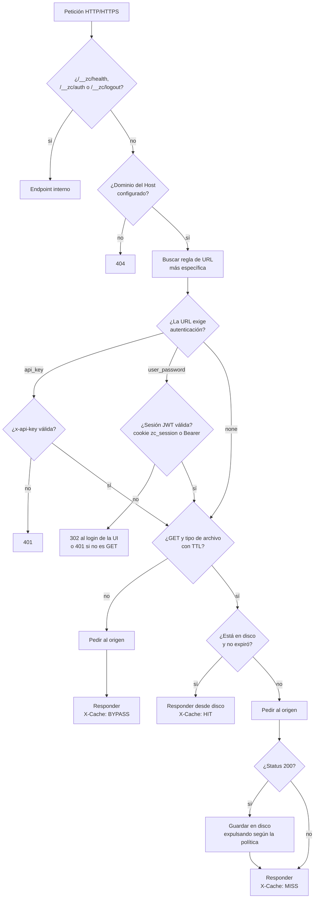
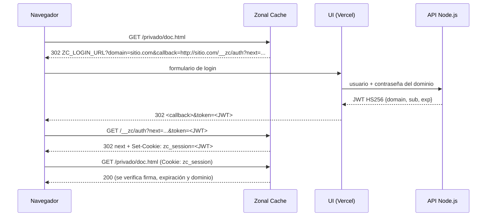

# Zonal Cache

Caché HTTP en disco escrita en **GNU C**. Cada zona geográfica tiene su propia instancia; el DNS Interceptor envía a cada cliente a la caché de su zona. La caché:

- guarda las respuestas en disco respetando el tamaño máximo por dominio y por URL definido en Firebase;
- aplica la política de reemplazo de cada URL: **LRU, LFU, FIFO, MRU o Random**;
- autentica con **`x-api-key`** o con **usuario y contraseña** (login en la UI y sesión verificada en cada petición);
- hace **SSL termination** (HTTPS con OpenSSL) y habla HTTP o HTTPS con el origen;
- recarga periódicamente su configuración desde el API Node.js.

Responsable: Fabricio Herrera Rodriguez.

## Contenido

1. [Flujo de una petición](#1-flujo-de-una-petición)
2. [Estructura del código](#2-estructura-del-código)
3. [Variables de entorno](#3-variables-de-entorno)
4. [Contrato con el API Node.js y la UI](#4-contrato-con-el-api-nodejs-y-la-ui)
5. [Compilar y ejecutar](#5-compilar-y-ejecutar)
6. [Pruebas](#6-pruebas)
7. [Despliegue en Kubernetes (Helm)](#7-despliegue-en-kubernetes-helm)
8. [Decisiones de diseño y limitaciones](#8-decisiones-de-diseño-y-limitaciones)
9. [Estado](#9-estado)
10. [Créditos](#10-créditos)

## 1. Flujo de una petición



Todas las respuestas llevan `X-Zonal-Cache: <zona>` para saber qué caché atendió.

### Login con usuario y contraseña



`GET /__zc/logout[?next=/ruta]` borra la cookie de sesión.

## 2. Estructura del código

| Archivo | Responsabilidad |
| --- | --- |
| [src/main.c](src/main.c) | Arranque, señales, hilo de refresco de configuración |
| [src/settings.c](src/settings.c) | Lectura y validación de variables de entorno |
| [src/server.c](src/server.c) | Sockets TCP, TLS (OpenSSL), un hilo por conexión |
| [src/http.c](src/http.c) | Parser de peticiones HTTP/1.x y armado de respuestas |
| [src/proxy.c](src/proxy.c) | Flujo autenticación → caché → origen (independiente de sockets) |
| [src/cache.c](src/cache.c) | Caché en disco con límites por dominio y por URL |
| [src/policy.c](src/policy.c) | Algoritmos de reemplazo LRU, LFU, FIFO, MRU, Random |
| [src/auth.c](src/auth.c) | SHA-256 de API keys y verificación de JWT HS256 |
| [src/site_config.c](src/site_config.c) | Lectura del JSON de dominios/URLs y búsqueda con comodines |
| [src/config_store.c](src/config_store.c) | Configuración vigente compartida entre hilos y su recarga |
| [src/origin.c](src/origin.c) | Cliente HTTP/HTTPS hacia el origen (libcurl) |
| [src/wildcard.c](src/wildcard.c) | Coincidencia de patrones `*` y `?` |
| [src/util.c](src/util.c), [src/log.c](src/log.c) | Utilidades (base64url, hashes, URL encoding) y bitácora |
| [tests/](tests/) | Pruebas unitarias (un archivo por módulo) |

### Interfaz de los algoritmos de reemplazo

La caché solo notifica eventos y pide víctimas; no sabe cómo se elige ([src/policy.h](src/policy.h)):

```c
policy_t   *policy_create(policy_type_t type, unsigned int seed);
int         policy_on_insert(policy_t *p, const char *key);
void        policy_on_access(policy_t *p, const char *key);
void        policy_on_remove(policy_t *p, const char *key);
const char *policy_pick_victim(policy_t *p);
```

Cada entrada guarda el momento de inserción (FIFO), el del último uso (LRU/MRU) y la cantidad de accesos (LFU; empate → la usada hace más tiempo). Random usa un generador propio con semilla.

### Caché en disco

```text
ZC_CACHE_DIR/
└── <hash del dominio>/            límite: maxCacheSize del dominio
    └── <hash del patrón de URL>/  límite: cacheSize de la URL, política propia
        └── <hash de la clave>-<id>.obj
```

- La clave de un objeto es `host + ruta + query`.
- Cada `.obj` tiene una cabecera de texto (status, fechas, Content-Type, longitud) seguida del cuerpo.
- Si un objeto no cabe, se expulsan entradas de su URL según la política. Si lo que se excede es el límite del dominio y esa URL está vacía, se expulsa de la URL del dominio que más espacio ocupa.
- Un objeto más grande que el límite no se guarda, para no vaciar la caché en vano.
- Si la UI reduce un límite, el exceso se expulsa en el siguiente acceso a esa URL.

## 3. Variables de entorno

No hay valores de despliegue quemados en el código.

| Variable | Descripción | Por defecto |
| --- | --- | --- |
| `ZC_ZONE` | Nombre de la zona (se devuelve en `X-Zonal-Cache`) | `default` |
| `ZC_HTTP_PORT` | Puerto HTTP | `8080` |
| `ZC_HTTPS_PORT` | Puerto HTTPS (SSL termination); `0` lo deshabilita | `0` |
| `ZC_TLS_CERT_FILE` | Certificado PEM (obligatorio si hay HTTPS) | — |
| `ZC_TLS_KEY_FILE` | Llave privada PEM (obligatoria si hay HTTPS) | — |
| `ZC_CACHE_DIR` | Directorio de la caché en disco (se vacía al iniciar) | `/var/cache/zonal-cache` |
| `ZC_CONFIG_URL` | Endpoint del API Node.js con la configuración | — |
| `ZC_CONFIG_TOKEN` | Token Bearer para `ZC_CONFIG_URL` | — |
| `ZC_CONFIG_FILE` | Alternativa a `ZC_CONFIG_URL`: archivo JSON local | — |
| `ZC_CONFIG_REFRESH_SECONDS` | Cada cuánto se recarga la configuración | `30` |
| `ZC_LOGIN_URL` | Formulario de login de la UI | — |
| `ZC_SESSION_SECRET` | Secreto HS256 compartido con el API Node.js | — |
| `ZC_ORIGIN_TIMEOUT_SECONDS` | Tiempo máximo de espera al origen | `15` |
| `ZC_ORIGIN_VERIFY_TLS` | `1` verifica el certificado del origen, `0` no | `1` |
| `ZC_MAX_BODY_BYTES` | Tamaño máximo de petición y de respuesta del origen | `10485760` |
| `ZC_LOG_LEVEL` | `debug`, `info`, `warn` o `error` | `info` |

Se requiere `ZC_CONFIG_URL` o `ZC_CONFIG_FILE`.

## 4. Contrato con el API Node.js y la UI

> Propuesta para T-01. Si cambia, hay que actualizar [src/site_config.c](src/site_config.c) y [src/auth.c](src/auth.c).

### 4.1 Configuración: `GET ZC_CONFIG_URL`

- Encabezado: `Authorization: Bearer <ZC_CONFIG_TOKEN>`.
- Respuesta `200` con todos los dominios verificados (registro TXT validado):

```json
{
  "domains": [
    {
      "name": "apache.p2.local",
      "origin": "http://apache",
      "maxCacheSize": 10485760,
      "urls": [
        {
          "pattern": "/*",
          "cacheSize": 5242880,
          "policy": "LRU",
          "auth": "none",
          "fileTypes": [
            { "extension": "html", "ttl": 60 },
            { "extension": "png", "ttl": 3600 }
          ]
        },
        {
          "pattern": "/api/*",
          "cacheSize": 1048576,
          "policy": "LFU",
          "auth": "api_key",
          "fileTypes": [{ "extension": "*", "ttl": 30 }],
          "apiKeys": ["<sha256 hexadecimal de la clave>"]
        }
      ]
    }
  ]
}
```

| Campo | Significado |
| --- | --- |
| `name` (o `domain`) | Dominio; admite comodines (`*.ejemplo.com`) |
| `origin` | Opcional. URL base del origen. Si falta se usa `http(s)://<Host>` |
| `maxCacheSize` | Bytes máximos en disco para el dominio |
| `urls[].pattern` | Ruta con comodines `*` y `?`. Gana el patrón más específico |
| `urls[].cacheSize` | Bytes máximos para esa URL |
| `urls[].policy` | `LRU`, `LFU`, `FIFO`, `MRU` o `RANDOM` (por defecto `LRU`) |
| `urls[].auth` | `none`, `api_key` o `user_password` |
| `urls[].fileTypes` | Extensión y TTL en segundos. `*` = cualquier tipo; TTL `0` = no guardar. Las rutas sin extensión cuentan como `html` |
| `urls[].apiKeys` | SHA-256 de cada API key válida (cadenas, u objetos `{ "hash": "..." }`) |

También se aceptan los nombres de campos del borrador del API Node.js ([Docs/Contratos/API-Node.md](../Docs/Contratos/API-Node.md)), así la caché funciona con cualquiera de los dos formatos mientras se cierra el contrato:

| Campo de la caché | Alternativa aceptada |
| --- | --- |
| `maxCacheSize` (dominio) | `maxCacheBytes` |
| `urls` | `rules` |
| `pattern` | `pathPattern` |
| `cacheSize` (URL) | `maxCacheBytes` |
| `auth` | `authMode` (`api-key`, `password`) |
| `fileTypes[].ttl` | `fileTypes[].ttlSeconds` |
| `policy` | `fileTypes[0].replacementPolicy` si la URL no define `policy` |
| `apiKeys[].hash` | `apiKeys[].keyHash` |

Solo se guardan respuestas `200` a `GET` cuyo tipo de archivo tiene TTL. El resto pasa directo al origen (`X-Cache: BYPASS`).

Las API keys se guardan como hash: el API nunca debe mandar la clave en texto plano. En Node.js:

```js
crypto.createHash("sha256").update(apiKey).digest("hex");
```

### 4.2 Sesiones de usuario y contraseña

1. La caché redirige a `ZC_LOGIN_URL?domain=<dominio>&callback=<url codificada>`.
2. La UI autentica a la persona con los usuarios de ese dominio (vía API Node.js).
3. El API emite un **JWT HS256** firmado con `ZC_SESSION_SECRET` con estos claims:

   ```json
   { "domain": "<dominio tal como viene en el parámetro domain>", "sub": "<usuario>", "exp": 1767225600 }
   ```

   ```js
   jwt.sign({ domain, sub: username }, process.env.ZC_SESSION_SECRET, { algorithm: "HS256", expiresIn: "1h" });
   ```

4. La UI redirige a `callback + "&token=" + encodeURIComponent(jwt)`.

Una sesión de un dominio no sirve en otro (`domain` debe coincidir). Los clientes que no son navegador pueden enviar `Authorization: Bearer <jwt>`.

## 5. Compilar y ejecutar

### Con Docker (recomendado)

```bash
docker build -t zonal-cache ./zonal-cache
```

### Entorno local completo con Docker Compose

Levanta la caché, un Apache de origen y un certificado autofirmado, con la configuración de [dev/config.json](dev/config.json):

```bash
docker compose -f zonal-cache/docker-compose.yml up --build
```

```bash
# MISS y luego HIT
curl -i -H "Host: apache.local" http://localhost:8080/index.html
curl -i -H "Host: apache.local" http://localhost:8080/index.html

# HTTPS (SSL termination, certificado autofirmado)
curl -ik -H "Host: apache.local" https://localhost:8443/index.html

# API key ("clave-valida" corresponde al hash de dev/config.json)
curl -i -H "Host: apache.local" http://localhost:8080/api/x.html                            # 401
curl -i -H "Host: apache.local" -H "x-api-key: clave-valida" http://localhost:8080/api/x.html

# Usuario y contraseña: redirige al login de la UI
curl -i -H "Host: apache.local" http://localhost:8080/privado/secreto.html                  # 302

# Sitio externo HTTP y HTTPS
curl -i -H "Host: example.com" http://localhost:8080/
curl -i -H "Host: www.wikipedia.org" http://localhost:8080/
```

### Compilación nativa (Linux)

```bash
sudo apt-get install build-essential libcurl4-openssl-dev libssl-dev libcjson-dev
cd zonal-cache
make
ZC_CONFIG_FILE=dev/config.json ZC_CACHE_DIR=/tmp/zc ./bin/zonal-cache
```

## 6. Pruebas

```bash
# En Docker (no requiere nada instalado aparte de Docker)
docker build --target test ./zonal-cache

# En Linux
cd zonal-cache && make test
```

El workflow [.github/workflows/zonal-cache.yml](../.github/workflows/zonal-cache.yml) las corre en cada push que toque `zonal-cache/`.

| Suite | Qué verifica |
| --- | --- |
| `policy` | Cada algoritmo elige la víctima correcta, empates de LFU, Random reproducible, cambio de algoritmo en caliente |
| `cache` | Lectura/escritura en disco, cuerpos binarios, expiración por TTL, límite por URL y por dominio, una víctima distinta por política, objetos demasiado grandes, reducción de límites, archivos borrados |
| `proxy` | HIT/MISS/BYPASS, errores no cacheados, 502, `x-api-key`, redirección al login, cookie y Bearer, callback `/__zc/auth`, logout, encabezados reenviados al origen, detección de bucles |
| `auth` | SHA-256, JWT generado con Node.js, firma alterada, expiración, dominio incorrecto, `alg: none` |
| `site_config` | JSON de ejemplo, comodines de dominio y URL, TTL por tipo de archivo, configuraciones inválidas |
| `http` | Parser de peticiones, cookies, Content-Length, serialización de respuestas |
| `settings`, `config_store`, `wildcard`, `util` | Variables de entorno, recarga de configuración entre hilos, comodines, codificaciones |

El flujo completo se prueba sin red: [tests/test_proxy.c](tests/test_proxy.c) reemplaza el origen por una función falsa (`origin_fetch_fn`).

## 7. Despliegue en Kubernetes (Helm)

El chart está en [deploy/helm/zonal-cache](../deploy/helm/zonal-cache) y crea un Deployment y un Service por zona (`america`, `europa`, `asia` por defecto).

```bash
# Con minikube: construir la imagen dentro del cluster
minikube image build -t zonal-cache:latest ./zonal-cache

helm upgrade --install zc ./deploy/helm/zonal-cache \
  --set config.url=https://<api-node>.vercel.app/api/cache/config \
  --set secrets.configToken=<token> \
  --set secrets.sessionSecret=<secreto> \
  --set loginUrl=https://<ui>.vercel.app/login

kubectl get svc -l app.kubernetes.io/name=zonal-cache   # IPs para el DNS Interceptor
```

- Para probar sin el API, usar `config.inline` en un archivo de valores (se monta como `ZC_CONFIG_FILE`).
- Para fijar la IP de cada zona (útil para el DNS Interceptor) usar `zones[].clusterIP`.
- Si `tls.existingSecret` está vacío, el chart genera un certificado autofirmado.

## 8. Decisiones de diseño y limitaciones

- **Un hilo por conexión y una petición por conexión** (`Connection: close`): simple de razonar. No hay keep-alive.
- **No se aceptan peticiones con `Transfer-Encoding: chunked`** (responde `411`); sí se aceptan con `Content-Length`. Las respuestas chunked del origen sí funcionan, porque libcurl las decodifica.
- **La búsqueda de víctima es O(n)** por URL. Para los tamaños del proyecto alcanza, y permite cambiar el algoritmo desde la UI sin reconstruir estructuras.
- **El índice vive en memoria**, por eso la caché se vacía al iniciar: los archivos sin índice no se podrían expulsar correctamente.
- **El tamaño contabilizado es el del archivo** (cabecera + cuerpo).
- **Solo se guarda `Content-Type`** de la respuesta del origen. Para evitar guardar contenido comprimido que otro cliente no acepte, no se reenvía `Accept-Encoding`.
- **Si el dominio no define `origin`**, se usa `http(s)://<Host>`. Dentro de Kubernetes el pod usa el DNS del cluster (no el interceptor), así que no vuelve a sí mismo. Por si acaso, el encabezado `X-Zonal-Cache-Hop` detecta bucles (`508`).

## 9. Estado

| Funcionalidad | Estado |
| --- | --- |
| Servidor HTTP (TCP, un hilo por conexión) | Implementado |
| SSL termination (HTTPS con OpenSSL) | Implementado |
| Caché en disco con límite por dominio y por URL | Implementado |
| LRU, LFU, FIFO, MRU, Random | Implementado |
| TTL por tipo de archivo | Implementado |
| Comodines en dominios y URLs | Implementado |
| Autenticación `x-api-key` | Implementado |
| Usuario y contraseña (login en la UI y sesión JWT) | Implementado en la caché; depende del API Node.js y la UI |
| Configuración desde Firebase (vía API Node.js) con recarga periódica | Implementado en la caché; depende del endpoint del API Node.js |
| Origen HTTP y HTTPS | Implementado |
| Dockerfile, Docker Compose y Helm Chart | Implementado |
| Pruebas unitarias | Implementado |

## 10. Créditos

- [cJSON](https://github.com/DaveGamble/cJSON) (MIT): lectura del JSON de configuración y de los JWT.
- [libcurl](https://curl.se/libcurl/) (licencia curl): peticiones al origen y al API.
- [OpenSSL](https://www.openssl.org/) (Apache 2.0): TLS, SHA-256 y HMAC.

Las librerías se instalan como paquetes del sistema y no se copió su código.
