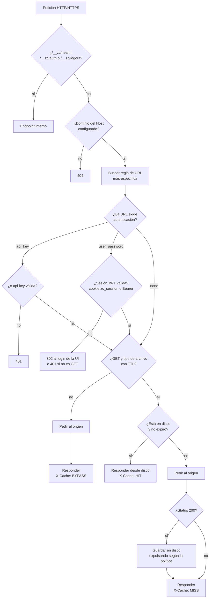
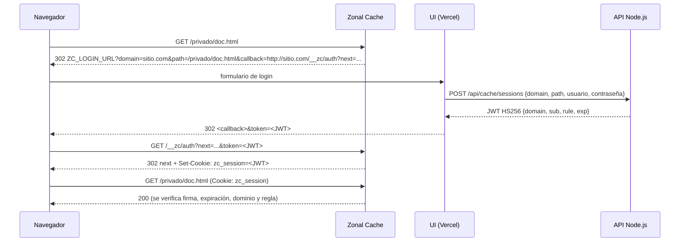

# Zonal Cache

Caché HTTP en disco escrita en **GNU C**. Cada zona geográfica tiene su propia instancia; el DNS Interceptor envía a cada cliente a la caché de su zona. La caché:

- guarda las respuestas en disco respetando el tamaño máximo por dominio y por URL definido en Firebase;
- aplica la política de reemplazo de cada tipo de archivo: **LRU, LFU, FIFO, MRU o Random**;
- autentica con **`x-api-key`** o con **usuario y contraseña** (login en la UI y sesión verificada en cada petición);
- hace **SSL termination** (HTTPS con OpenSSL) y habla HTTP o HTTPS con el origen;
- recarga periódicamente su configuración desde el API Node.js.

Responsable: Fabricio Herrera Rodriguez.

## Contenido

1. [Flujo de una petición](#1-flujo-de-una-petición)
2. [Estructura del código](#2-estructura-del-código)
3. [Variables de entorno](#3-variables-de-entorno)
4. [Contrato con el API Node.js y la UI](#4-contrato-con-el-api-nodejs-y-la-ui)
5. [Compilar y ejecutar](#5-compilar-y-ejecutar)
6. [Pruebas](#6-pruebas)
7. [Despliegue en Kubernetes (Helm)](#7-despliegue-en-kubernetes-helm)
8. [Decisiones de diseño y limitaciones](#8-decisiones-de-diseño-y-limitaciones)
9. [Estado](#9-estado)
10. [Créditos](#10-créditos)

## 1. Flujo de una petición



Todas las respuestas llevan `X-Zonal-Cache: <zona>` para saber qué caché atendió.

### Login con usuario y contraseña



`GET /__zc/logout[?next=/ruta]` borra la cookie de sesión.

## 2. Estructura del código

| Archivo | Responsabilidad |
| --- | --- |
| [src/main.c](src/main.c) | Arranque, señales, hilo de refresco de configuración |
| [src/settings.c](src/settings.c) | Lectura y validación de variables de entorno |
| [src/server.c](src/server.c) | Sockets TCP, TLS (OpenSSL), un hilo por conexión |
| [src/http.c](src/http.c) | Parser de peticiones HTTP/1.x y armado de respuestas |
| [src/proxy.c](src/proxy.c) | Flujo autenticación → caché → origen (independiente de sockets) |
| [src/cache.c](src/cache.c) | Caché en disco con límites por dominio y por URL |
| [src/policy.c](src/policy.c) | Algoritmos de reemplazo LRU, LFU, FIFO, MRU, Random |
| [src/auth.c](src/auth.c) | SHA-256 de API keys y verificación de JWT HS256 |
| [src/site_config.c](src/site_config.c) | Lectura del JSON de dominios/URLs y búsqueda con comodines |
| [src/config_store.c](src/config_store.c) | Configuración vigente compartida entre hilos y su recarga |
| [src/origin.c](src/origin.c) | Cliente HTTP/HTTPS hacia el origen (libcurl) |
| [src/wildcard.c](src/wildcard.c) | Coincidencia de patrones `*` y `?` |
| [src/util.c](src/util.c), [src/log.c](src/log.c) | Utilidades (base64url, hashes, URL encoding) y bitácora |
| [tests/](tests/) | Pruebas unitarias (un archivo por módulo) |

### Interfaz de los algoritmos de reemplazo

La caché solo notifica eventos y pide víctimas; no sabe cómo se elige ([src/policy.h](src/policy.h)):

```c
policy_t   *policy_create(policy_type_t type, unsigned int seed);
int         policy_on_insert(policy_t *p, const char *key);
void        policy_on_access(policy_t *p, const char *key);
void        policy_on_remove(policy_t *p, const char *key);
const char *policy_pick_victim(policy_t *p);
```

Cada entrada guarda el momento de inserción (FIFO), el del último uso (LRU/MRU) y la cantidad de accesos (LFU; empate → la usada hace más tiempo). Random usa un generador propio con semilla.

### Caché en disco

```text
ZC_CACHE_DIR/
└── <hash del dominio>/            límite: maxCacheSize del dominio
    └── <hash del patrón de URL>/  límite: cacheSize compartido por los tipos
        └── <hash de la clave>-<id>.obj
```

- La clave de un objeto es `host + ruta + query`.
- Cada `.obj` tiene una cabecera de texto (status, fechas, Content-Type, longitud) seguida del cuerpo.
- Si un objeto no cabe, se expulsan entradas de su tipo según su política. Si ese tipo está vacío, se usa el que más espacio ocupa en la URL, con su propia política. Si lo que se excede es el límite del dominio y esa URL está vacía, se expulsa de la URL del dominio que más espacio ocupa.
- Un objeto más grande que el límite no se guarda, para no vaciar la caché en vano.
- Si la UI reduce un límite, el exceso se expulsa en el siguiente acceso a esa URL.
- Un solo mutex protege el índice, porque cada conexión se atiende en su propio hilo.

### Encabezados hacia el origen

[src/proxy.c](src/proxy.c) (`build_origin_headers`) copia los encabezados del cliente, excepto:

| Se elimina | Por qué |
| --- | --- |
| Hop-by-hop (`Connection`, `Keep-Alive`, `Transfer-Encoding`, ...) | Solo valen para un salto |
| `Host`, `Content-Length`, `Expect` | libcurl los arma para el origen |
| `Accept-Encoding` | Así el origen responde sin comprimir y el cuerpo guardado sirve para cualquier cliente |
| `x-api-key` | La clave es para la caché; no se filtra al origen |
| `Authorization: Bearer ...` en reglas de usuario/contraseña | Era el JWT de la caché |
| Cookie `zc_session` | Las demás cookies sí pasan |

Se agregan `X-Forwarded-For` (IP del cliente), `X-Forwarded-Proto` (`http` o `https`), `X-Forwarded-Host` y `X-Zonal-Cache-Hop: 1`, que permite detectar bucles. libcurl no sigue redirecciones del origen: las devuelve al cliente.

### Configuración compartida entre hilos

[src/config_store.c](src/config_store.c) guarda la configuración vigente con un conteo de referencias. Cada petición toma una referencia al empezar y la suelta al terminar. Cuando llega una configuración nueva, el puntero se reemplaza de una vez, y la anterior se libera cuando termina la última petición que la usaba. Si la descarga o el JSON fallan, se conserva la configuración anterior.

## 3. Variables de entorno

No hay valores de despliegue quemados en el código.

| Variable | Descripción | Por defecto |
| --- | --- | --- |
| `ZC_ZONE` | Nombre de la zona (se devuelve en `X-Zonal-Cache`) | `default` |
| `ZC_HTTP_PORT` | Puerto HTTP | `8080` |
| `ZC_HTTPS_PORT` | Puerto HTTPS (SSL termination); `0` lo deshabilita | `0` |
| `ZC_TLS_CERT_FILE` | Certificado PEM (obligatorio si hay HTTPS) | — |
| `ZC_TLS_KEY_FILE` | Llave privada PEM (obligatoria si hay HTTPS) | — |
| `ZC_CACHE_DIR` | Directorio de la caché en disco (se vacía al iniciar) | `/var/cache/zonal-cache` |
| `ZC_CONFIG_URL` | Endpoint del API Node.js con la configuración | — |
| `ZC_CONFIG_TOKEN` | Token Bearer para `ZC_CONFIG_URL` | — |
| `ZC_CONFIG_FILE` | Alternativa a `ZC_CONFIG_URL`: archivo JSON local | — |
| `ZC_CONFIG_REFRESH_SECONDS` | Cada cuánto se recarga la configuración | `30` |
| `ZC_LOGIN_URL` | Formulario de login de la UI | — |
| `ZC_SESSION_SECRET` | Secreto HS256 compartido con el API Node.js | — |
| `ZC_ORIGIN_TIMEOUT_SECONDS` | Tiempo máximo de espera al origen | `15` |
| `ZC_ORIGIN_VERIFY_TLS` | `1` verifica el certificado del origen, `0` no | `1` |
| `ZC_MAX_BODY_BYTES` | Tamaño máximo de petición y de respuesta del origen | `10485760` |
| `ZC_LOG_LEVEL` | `debug`, `info`, `warn` o `error` | `info` |

Se requiere `ZC_CONFIG_URL` o `ZC_CONFIG_FILE`.

## 4. Contrato con el API Node.js y la UI

> `GET /api/cache/config` ya está implementado en el API ([api-node/cache.js](../api-node/cache.js)). Si el contrato cambia, hay que actualizar [src/site_config.c](src/site_config.c) y [src/auth.c](src/auth.c).

### 4.1 Configuración: `GET ZC_CONFIG_URL`

- Encabezado: `Authorization: Bearer <ZC_CONFIG_TOKEN>`.
- Respuesta `200` con todos los dominios verificados (registro TXT validado):

```json
{
  "domains": [
    {
      "name": "apache.p2.local",
      "origin": "http://apache-apache",
      "maxCacheSize": 10485760,
      "urls": [
        {
          "id": "regla-1",
          "pattern": "/*",
          "cacheSize": 5242880,
          "policy": "LRU",
          "auth": "none",
          "fileTypes": [
            { "extension": "html", "ttl": 60 },
            { "extension": "png", "ttl": 3600 }
          ]
        },
        {
          "pattern": "/api/*",
          "cacheSize": 1048576,
          "policy": "LFU",
          "auth": "api_key",
          "fileTypes": [{ "extension": "*", "ttl": 30 }],
          "apiKeys": ["<sha256 hexadecimal de la clave>"]
        }
      ]
    }
  ]
}
```

| Campo | Significado |
| --- | --- |
| `name` (o `domain`) | Dominio; admite comodines (`*.ejemplo.com`) |
| `origin` | URL base del servidor de origen (en Kubernetes, el Service: `http://apache-apache`). Si falta se usa `http(s)://<Host>` |
| `urls[].id` | Opcional. Id de la regla en Firestore; debe coincidir con el claim `rule` de la sesión |
| `maxCacheSize` | Bytes máximos en disco para el dominio |
| `urls[].pattern` | Ruta con comodines `*` y `?`. Gana el patrón más específico |
| `urls[].cacheSize` | Bytes máximos para esa URL |
| `urls[].policy` | Política por defecto para los tipos que no tienen una propia: `LRU`, `LFU`, `FIFO`, `MRU` o `RANDOM` (por defecto `LRU`) |
| `urls[].auth` | `none`, `api_key` o `user_password` |
| `urls[].fileTypes` | Extensión, TTL en segundos y `replacementPolicy` por tipo. `*` = cualquier tipo; TTL `0` = no guardar. Las rutas sin extensión cuentan como `html` |
| `urls[].apiKeys` | SHA-256 de cada API key válida (cadenas, u objetos `{ "hash": "..." }`) |

También se aceptan los nombres de campos del borrador del API Node.js ([Docs/Contratos/API-Node.md](../Docs/Contratos/API-Node.md)), así la caché funciona con cualquiera de los dos formatos mientras se cierra el contrato:

| Campo de la caché | Alternativa aceptada |
| --- | --- |
| `origin` | `originUrl` |
| `maxCacheSize` (dominio) | `maxCacheBytes` |
| `urls` | `rules` |
| `pattern` | `pathPattern` |
| `cacheSize` (URL) | `maxCacheBytes` |
| `auth` | `authMode` (`api-key`, `password`) |
| `fileTypes[].ttl` | `fileTypes[].ttlSeconds` |
| `policy` | `replacementPolicy` en la regla, como valor por defecto; cada `fileTypes[].replacementPolicy` tiene prioridad para su tipo |
| `apiKeys[].hash` | `apiKeys[].keyHash` |

Solo se guardan respuestas `200` a `GET` cuyo tipo de archivo tiene TTL y que el origen no marcó con `Cache-Control: no-store` o `private`. El resto pasa directo al origen (`X-Cache: BYPASS`).

**Diferencias actuales con el API Node.js** ([api-node/rules.js](../api-node/rules.js)):

- El API solo acepta `authMode` `api-key` o `password`. La caché también soporta `none`, pero desde la UI todavía no se puede crear una regla pública. Una ruta sin regla se sirve, pero como `BYPASS`, sin guardarse.
- El API no acepta el tipo de archivo `*`, así que hay que listar cada extensión. Las rutas sin extensión (`/`, `/api/items`) cuentan como `html`.
- La UI y la caché usan una política por tipo de archivo. El límite de tamaño sigue siendo el total de la regla; no se multiplica por la cantidad de tipos.
- `ttlSeconds: 0` significa "no guardar ese tipo".

Las API keys se guardan como hash: el API nunca debe mandar la clave en texto plano. En Node.js:

```js
crypto.createHash("sha256").update(apiKey).digest("hex");
```

### 4.2 Sesiones de usuario y contraseña

1. La caché redirige a `ZC_LOGIN_URL?domain=<dominio>&path=<ruta>&callback=<url codificada>`.
   Con la UI de Vercel: `ZC_LOGIN_URL=https://<ui>.vercel.app/#/acceso-recurso`.
2. La UI envía `domain`, `path`, usuario y contraseña al API (`POST /api/cache/sessions`), que busca la regla de esa ruta y valida el usuario.
3. El API emite un **JWT HS256** firmado con `ZC_SESSION_SECRET` con estos claims:

   ```json
   { "domain": "<dominio tal como viene en el parámetro domain>", "sub": "<usuario>", "rule": "<id de la regla>", "exp": 1767225600 }
   ```

   ```js
   jwt.sign({ domain, sub: username, rule: ruleId }, process.env.ZC_SESSION_SECRET, { algorithm: "HS256", expiresIn: "1h" });
   ```

4. La UI redirige a `callback + "&token=" + encodeURIComponent(jwt)`.

Una sesión de un dominio no sirve en otro (`domain` debe coincidir). Si el token trae `rule`, solo sirve para la regla con ese `id`; si no lo trae, sirve para todas las URLs con usuario y contraseña del dominio. Los clientes que no son navegador pueden enviar `Authorization: Bearer <jwt>`.

## 5. Compilar y ejecutar

### Con Docker (recomendado)

```bash
docker build -t zonal-cache ./zonal-cache
```

### Entorno local completo con Docker Compose

Levanta la caché, un Apache de origen y un certificado autofirmado, con la configuración de [dev/config.json](dev/config.json):

```bash
docker compose -f zonal-cache/docker-compose.yml up --build
```

```bash
# MISS y luego HIT
curl -i -H "Host: apache.local" http://localhost:8080/index.html
curl -i -H "Host: apache.local" http://localhost:8080/index.html

# HTTPS (SSL termination, certificado autofirmado)
curl -ik -H "Host: apache.local" https://localhost:8443/index.html

# API key ("clave-valida" corresponde al hash de dev/config.json)
curl -i -H "Host: apache.local" http://localhost:8080/api/x.html                            # 401
curl -i -H "Host: apache.local" -H "x-api-key: clave-valida" http://localhost:8080/api/x.html

# Usuario y contraseña: redirige al login de la UI
curl -i -H "Host: apache.local" http://localhost:8080/privado/secreto.html                  # 302

# Sitio externo HTTP y HTTPS
curl -i -H "Host: example.com" http://localhost:8080/
curl -i -H "Host: www.wikipedia.org" http://localhost:8080/
```

Resultados obtenidos el 03/11/2026:

| Petición | Resultado |
| --- | --- |
| Apache, 1.ª y 2.ª | `200`, `X-Cache: MISS` y luego `HIT` |
| HTTPS en el 8443 | `200` |
| `/api/x.html` sin clave | `401` |
| `/api/x.html` con `clave-valida` | `404`: la clave se acepta, pero `dev/html/api/x.html` no existe |
| `/privado/secreto.html` | `302` al login con `domain`, `path` y `callback` |
| example.com y wikipedia, 1.ª y 2.ª | `200`, MISS y luego HIT |

Con wikipedia aparecen dos encabezados: `x-cache` en minúsculas es del CDN de Wikipedia y `X-Cache` es el de la caché zonal.

El contenedor `certs` genera el certificado autofirmado en `dev/certs/`, que está en `.gitignore`. La caché solo arranca si ese contenedor termina bien (`service_completed_successfully`).

### Compilación nativa (Linux)

```bash
sudo apt-get install build-essential libcurl4-openssl-dev libssl-dev libcjson-dev
cd zonal-cache
make
ZC_CONFIG_FILE=dev/config.json ZC_CACHE_DIR=/tmp/zc ./bin/zonal-cache
```

## 6. Pruebas

```bash
# En Docker (no requiere nada instalado aparte de Docker)
docker build --target test ./zonal-cache

# En Linux
cd zonal-cache && make test
```

El workflow [.github/workflows/zonal-cache.yml](../.github/workflows/zonal-cache.yml) las corre en cada push que toque `zonal-cache/`.

| Suite | Qué verifica |
| --- | --- |
| `policy` | Cada algoritmo elige la víctima correcta, empates de LFU, Random reproducible, cambio de algoritmo en caliente |
| `cache` | Lectura/escritura en disco, cuerpos binarios, expiración por TTL, límite por URL y por dominio, una víctima distinta por política, objetos demasiado grandes, reducción de límites, archivos borrados |
| `proxy` | HIT/MISS/BYPASS, errores no cacheados, 502, `x-api-key`, redirección al login, cookie y Bearer, callback `/__zc/auth`, logout, encabezados reenviados al origen, detección de bucles |
| `auth` | SHA-256, JWT generado con Node.js, firma alterada, expiración, dominio incorrecto, `alg: none` |
| `site_config` | JSON de ejemplo, comodines de dominio y URL, TTL por tipo de archivo, configuraciones inválidas |
| `http` | Parser de peticiones, cookies, Content-Length, serialización de respuestas |
| `settings`, `config_store`, `wildcard`, `util` | Variables de entorno, recarga de configuración entre hilos, comodines, codificaciones |

El flujo completo se prueba sin red: [tests/test_proxy.c](tests/test_proxy.c) reemplaza el origen por una función falsa (`origin_fetch_fn`).

Resultado actual: **102 pruebas, 0 fallidas**. Incluyen políticas distintas para HTML y CSS en una misma regla, los límites compartidos de URL y dominio y el cambio de política sin reiniciar la caché.

### Pruebas de integración en Kubernetes

Con los charts instalados, [deploy/test-k8s.sh](../deploy/test-k8s.sh) prueba la caché junto con el DNS Interceptor y los orígenes desde un pod del cluster. Cubre health por zona, MISS y luego HIT, independencia entre zonas, HTTPS, `x-api-key`, GET/POST/PUT/DELETE de la Rest API Java, y los errores `404` y `508`. Ver la [sección 6.6 del README principal](../README.md#66-verificar-que-todo-funciona).

## 7. Despliegue en Kubernetes (Helm)

El chart está en [deploy/helm/zonal-cache](../deploy/helm/zonal-cache) y crea un Deployment y un Service por zona (`america`, `europa`, `asia` por defecto).

```bash
# Con Kubernetes de Docker Desktop basta con docker build -t zonal-cache zonal-cache.
# Con minikube: construir la imagen dentro del cluster
minikube image build -t zonal-cache:latest ./zonal-cache

helm upgrade --install zc ./deploy/helm/zonal-cache \
  --set config.url=https://<api-node>.vercel.app/api/cache/config \
  --set secrets.configToken=<token> \
  --set secrets.sessionSecret=<secreto> \
  --set loginUrl='https://<ui>.vercel.app/#/acceso-recurso'

kubectl get svc -l app.kubernetes.io/name=zonal-cache   # IPs para el DNS Interceptor
```

- Para probar sin el API, usar `config.inline` en un archivo de valores (se monta como `ZC_CONFIG_FILE`). [values-local.yaml](../deploy/helm/zonal-cache/values-local.yaml) ya trae Apache y la Rest API Java de los charts de `deploy/helm`.
- La integración con el DNS Interceptor, el API y la UI está en [Docs/Integracion.md](../Docs/Integracion.md).
- Para fijar la IP de cada zona (útil para el DNS Interceptor) usar `zones[].clusterIP`.
- Si `tls.existingSecret` está vacío, el chart genera un certificado autofirmado.

## 8. Decisiones de diseño y limitaciones

- **Un hilo por conexión y una petición por conexión** (`Connection: close`): simple de razonar. No hay keep-alive.
- **No se aceptan peticiones con `Transfer-Encoding: chunked`** (responde `411`); sí se aceptan con `Content-Length`. Las respuestas chunked del origen sí funcionan, porque libcurl las decodifica.
- **La búsqueda de víctima es O(n)** por URL. Para los tamaños del proyecto alcanza, y permite cambiar el algoritmo desde la UI sin reconstruir estructuras.
- **El índice vive en memoria**, por eso la caché se vacía al iniciar: los archivos sin índice no se podrían expulsar correctamente.
- **El tamaño contabilizado es el del archivo** (cabecera + cuerpo).
- **Solo se guarda `Content-Type`** de la respuesta del origen. Para evitar guardar contenido comprimido que otro cliente no acepte, no se reenvía `Accept-Encoding`.
- **Si el dominio no define `origin`**, se usa `http(s)://<Host>`. Dentro de Kubernetes el pod usa el DNS del cluster (no el interceptor), así que no vuelve a sí mismo. Por si acaso, el encabezado `X-Zonal-Cache-Hop` detecta bucles (`508`).

## 9. Estado

| Funcionalidad | Estado |
| --- | --- |
| Servidor HTTP (TCP, un hilo por conexión) | Implementado |
| SSL termination (HTTPS con OpenSSL) | Implementado |
| Caché en disco con límite por dominio y por URL | Implementado |
| LRU, LFU, FIFO, MRU, Random | Implementado |
| TTL por tipo de archivo | Implementado |
| Comodines en dominios y URLs | Implementado |
| Autenticación `x-api-key` | Implementado |
| Usuario y contraseña (login en la UI y sesión JWT) | Implementado en la caché (redirección, callback, cookie, Bearer, logout). El login completo depende de `POST /api/cache/sessions`, pendiente en el API |
| Configuración desde Firebase (vía API Node.js) con recarga periódica | Implementado en la caché, y `GET /api/cache/config` existe en el API. Mientras el API no marque dominios como verificados (TXT), las pruebas usan `config.inline` (`values-local.yaml`) |
| Origen HTTP y HTTPS | Implementado y probado (Apache, Rest API Java, example.com, wikipedia) |
| Dockerfile, Docker Compose y Helm Chart | Implementado y probado en Kubernetes de Docker Desktop |
| Pruebas unitarias | 102 pruebas, 0 fallidas |
| Pruebas de integración en Kubernetes | [deploy/test-k8s.sh](../deploy/test-k8s.sh) |

## 10. Créditos

- [cJSON](https://github.com/DaveGamble/cJSON) (MIT): lectura del JSON de configuración y de los JWT.
- [libcurl](https://curl.se/libcurl/) (licencia curl): peticiones al origen y al API.
- [OpenSSL](https://www.openssl.org/) (Apache 2.0): TLS, SHA-256 y HMAC.

Las librerías se instalan como paquetes del sistema y no se copió su código.
